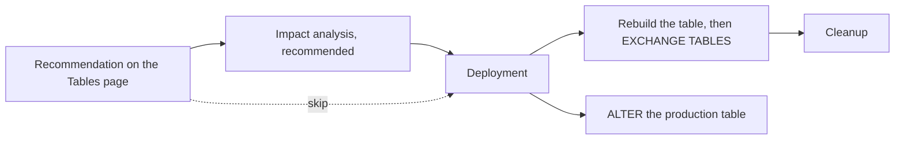

import { PrivatePreviewBadge } from '/snippets/ar/components/PrivatePreviewBadge/PrivatePreviewBadge.jsx';

<PrivatePreviewBadge />

يساعدك Schema Advisor على ترحيل المخطط في ClickHouse Cloud، بدءًا من التوصية، مرورًا بتحليل الأثر على عينة من بياناتك، وصولًا إلى نشر توافق عليه.

في ClickHouse، يحدد المخطط طريقة تخزين الجدول: المفتاح الأساسي، ومفتاح `ORDER BY`، والضغط، والفهارس، والإسقاطات. فاختيار مفتاح `ORDER BY` أفضل قد يحوّل المسح الكامل للجدول إلى قراءة عدد قليل من حبيبات البيانات،
كما أن مرمّز ضغط أفضل قد يقلل مساحة التخزين التي يشغلها الجدول.
ويتطلب إجراء هذا التغيير على جدول بيئة الإنتاج وجود خطة، والتحقق من صحتها، ثم طرحها بأقل مدة توقف ممكنة.

يساعدك Schema Advisor في إنجاز ذلك. إذ تُستخلص التوصيات من سجلات الاستعلامات لديك في [المراقبة](/ar/products/cloud/features/monitoring/recommendations#schema-recommendations)، وتستند إلى اختبارات حتمية، لا إلى الذكاء الاصطناعي.
وإذا أردت تطبيق هذه التوصيات، يقترح Schema Advisor الخطة اللازمة لتحقيق ذلك.
ويتولى سير عمل متين تنفيذ أوامر SQL، على أن توافق أنت على كل خطوة قبل أن يواصل سير العمل.

<Warning>
  Schema Advisor ميزة في مرحلة المعاينة، وقد تتغير، ولا تشملها اتفاقية مستوى الخدمة القياسية لـ ClickHouse Cloud.
</Warning>

## طلب الوصول {#request-access}

تتوفر ميزة Schema Advisor في ClickHouse Cloud. ولا تشمل هذه المعاينة [استخدم بنيتك السحابية الخاصة (BYOC)](/ar/cloud/reference/byoc/overview) ولا [ClickHouse Private](/ar/cloud/infrastructure/clickhouse-private).

<Steps>
  <Step title="افتح ميزات المعاينة">
    سجّل الدخول إلى وحدة تحكم ClickHouse Cloud، واختر مؤسستك، ثم افتح **ميزات المعاينة** من قائمة المؤسسة. راجع [معاينات الخدمة الذاتية](/ar/products/cloud/features/self-service-previews).
  </Step>

  <Step title="اطلب الوصول إلى Schema Advisor">
    ابحث عن **Schema Advisor**، واختر **Learn more**، ثم اختر **Request access**. سنرسل إليك رسالة عبر البريد الإلكتروني فور تفعيل الوصول.
    بعض المعاينات تكون مخفية لدى بعض المؤسسات. إذا لم تجد Schema Advisor في القائمة، فتواصل مع [فريق دعم Cloud](https://clickhouse.com/support/program).
  </Step>
</Steps>

## كيف ينتقل التغيير {#how-a-change-moves}

تحليل الأثر اختياري لكنه موصى به بشدة. إذا كنت تثق بالتوصية، فيمكنك الانتقال مباشرةً إلى نشر تغيير المخطط.
وإلا، فشغّل تحليل الأثر أولًا لتطّلع على تأثير التغيير في استعلاماتك قبل إجراء أي تعديل على جدول بيئة الإنتاج.

## البدء من توصية {#start-from-a-recommendation}

بعد أن تحصل مؤسستك على حق الوصول، افتح خدمة وانتقل إلى [**المراقبة**](/ar/products/cloud/features/monitoring/cloud-console)، ثم **Tables**.
يعرض Schema Advisor التوصية الخاصة بالجدول والاستعلامات التي بُنيت عليها. راجع [رؤى الاستعلامات](/ar/products/cloud/features/sql-console-features/query-insights) للاطلاع على سجل الاستعلامات الذي تستند إليه هذه التوصيات.
عندما تكون مستعدًا لتطبيق التوصية، انقر على **Generate Implementation Plan** أسفل صفحة التوصية.
تضم صفحة Tables التوصية وخطط التنفيذ، ويمكنك العودة إليها في أي وقت لمتابعة التنفيذ، أو مواصلة المحادثة في ClickHouse Assistant.

إذا كنت تعرف تغيير المخطط الذي تريده ولم يظهر لذلك الجدول، فيمكنك البدء من ClickHouse Assistant.
صِف التغيير واطلب من Schema Advisor أن يرشدك خلال تنفيذه.
على سبيل المثال: &quot;أرغب في تغيير المفتاح الأساسي لجدولي default.sales&#95;analysis. استخدم Schema Advisor لمساعدتي في ذلك.&quot;

يمكنك أيضًا أن تطلب توصيات من ClickHouse Assistant، إذ سيتحقق أولًا من وجود أي توصيات حتمية سابقة،
ثم يُجري بعض التحليلات المخصصة لتقديم توصيات إضافية.
نوصي بشدة بإجراء تحليل الأثر قبل نشر التوصيات التي يولّدها نموذج اللغة الكبير (LLM).

## تحليل الأثر {#impact-analysis}

يُعِدّ Schema Advisor خطة ويعرض استعلامات SQL لكل خطوة. وبعد موافقتك، يبدأ تنفيذ سير العمل.

1. نأخذ عينة من جدول بيئة الإنتاج لتكون جدول القيمة المرجعية. ويبلغ حجم هذه العينة حاليًا 10,000,000 صف.
2. بالقراءة من جدول القيمة المرجعية، ننشئ جدولًا مرشّحًا بالمخطط المقترح.
3. نعيد تنفيذ الاستعلامات الأكثر تشغيلًا على جدول بيئة الإنتاج هذا 3 مرات على كلٍّ من جدول القيمة المرجعية والجدول المرشّح.
4. تعرض النتائج عمليات التشغيل هذه جنبًا إلى جنب، مع حساب المتوسط عبر جميع الاستعلامات. وتشمل المقاييس المقارَنة: وقت تنفيذ الاستعلام، وعدد الصفوف التي جرى فحصها، وحجم البيانات المقروءة.

يمكنك اختيار مكان تشغيل التحليل:

* **في الخدمة الحالية.** يستخدم التحليل الخدمة التي تعمل فيها حاليًا.
* **في خدمة معزولة.** ينشئ Schema Advisor خدمة مؤقتة منفصلة مُستعادة من أحدث نسخة احتياطية لديك. ولاستخدام هذا الخيار، يجب أن تكون قد أعددت النسخ الاحتياطية.
  تُشغَّل استعلامات اختبار الأداء المقارن على تلك النسخة من البيانات. ويختلف ذلك عن [المستودع](/ar/products/cloud/features/infrastructure/warehouses)، حيث تتشارك الخدمات التخزين نفسه.

## نشر تغيير {#deploy-a-change}

إذا كانت نتائج تحليل الأثر مُرضية، يمكنك المتابعة إلى النشر، وإلا فيمكنك تجاهل التوصية. ويختلف التنفيذ بحسب نوع التغيير.

* **إعادة بناء كاملة للجدول.** تتطلب تغييرات مخطط قاعدة البيانات التالية إعادة بناء كاملة: تغيير ترتيب الفرز، أو تغيير المفتاح الأساسي.
  ينشئ Schema Advisor الجدول الجديد، وينسخ البيانات، ويتحقق من النسخة، ثم يبدّلها لتحل محل الجدول الأصلي باستخدام [`EXCHANGE TABLES`](/ar/sql-reference/statements/exchange).
  عملية التبادل ذرّية، لذا يصبح اسم جدول بيئة الإنتاج مشيرًا إلى الجدول الجديد دون أي مدة توقف.
  يعرض Schema Advisor العبارة الدقيقة، ويشغّلها سير العمل بعد موافقتك عليها.
  بعد التبديل، لا يُحذف الجدول القديم تلقائيًا، ولا تُنفَّذ [عملية التنظيف](#cleanup) إلا بعد النقر على الزر.
* **`ALTER TABLE`.** تُطبَّق هذه التغييرات مباشرةً على الجدول نفسه، دون إعادة بناء ودون `EXCHANGE TABLES`، ومنها إضافة فهرس أو إسقاط.
  يعرض Schema Advisor عبارة `ALTER` الدقيقة، وبعد موافقتك عليها، يشغّل سير العمل تلك العبارة على جدول بيئة الإنتاج.

## التنظيف {#cleanup}

بعد إعادة بناء الجدول بالكامل، يُحتفَظ بالجدول القديم كنسخة احتياطية. ولا تبدأ عملية التنظيف إلا بعد النقر على زر **Clean up**.
وعند النقر عليه، يحذف Schema Advisor جميع جداول النسخ الاحتياطية الموجودة وجميع الخدمات المؤقتة.

## النماذج ومعالجة البيانات {#models-and-data-handling}

افتراضيًا، تمر استدعاءات النماذج الصادرة من Schema Advisor عبر ClickHouse Inference Gateway على Amazon Bedrock.

لا ندرّب النماذج على بياناتك. والمعلومات الوحيدة التي تُرسَل إلى النموذج هي البيانات الوصفية لمخطط الجدول لديك، إضافةً إلى التوصية.

## القيود {#limitations}

في مرحلة المعاينة الخاصة هذه، لا يتوفر نشر التغييرات التي تتطلب إعادة بناء الجدول بالكامل في الحالات التالية:

* عندما يستوعب الجدول البيانات بشكل مستمر.
* عندما يحتوي الجدول على أكثر من 100 مليون صف، أو يتجاوز حجمه 100 GB، أيهما يتحقق أولاً. ومع ذلك، لا يزال بإمكانك إنشاء خطة وإجراء تحليل الأثر.
* عندما تعتمد على الجدول كائنات تابعة، بما في ذلك [العروض المُجسَّدة](/ar/materialized-views).

## صفحات ذات صلة {#related-pages}

* [المراقبة في وحدة تحكم ClickHouse Cloud](/ar/products/cloud/features/monitoring/cloud-console)
* [رؤى الاستعلامات](/ar/products/cloud/features/sql-console-features/query-insights)
* [المستودعات](/ar/products/cloud/features/infrastructure/warehouses)
* [تصميم المخطط](/ar/data-modeling/schema-design)
* [معاينات الخدمة الذاتية](/ar/products/cloud/features/self-service-previews)
* [`EXCHANGE`](/ar/sql-reference/statements/exchange)