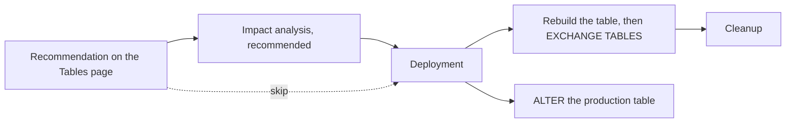

import { PrivatePreviewBadge } from '/snippets/es/components/PrivatePreviewBadge/PrivatePreviewBadge.jsx';

<PrivatePreviewBadge />

Schema Advisor le ayuda a migrar su esquema en ClickHouse Cloud, desde una recomendación y un análisis de impacto sobre una muestra de sus datos hasta una implementación que usted aprueba.

En ClickHouse, el esquema determina cómo se almacena una tabla: la clave primaria, la clave `ORDER BY`, la compresión, los índices y las proyecciones. Un `ORDER BY` mejor elegido puede convertir un escaneo completo de la tabla en la lectura de unos pocos gránulos,
y un códec de compresión más adecuado puede reducir el almacenamiento que ocupa una tabla.
Aplicar ese cambio en una tabla de producción exige contar con un plan, validarlo y llevar a cabo una implementación con el menor tiempo de inactividad posible.

Schema Advisor le ayuda con esa tarea. Las recomendaciones proceden de sus registros de consultas en [Monitorización](/es/products/cloud/features/monitoring/recommendations#schema-recommendations) y se basan en pruebas deterministas, no en IA generativa.
Si desea aplicar esas recomendaciones, Schema Advisor le propone el plan para hacerlo.
Un flujo de trabajo duradero ejecuta el SQL y usted aprueba cada paso antes de que el flujo de trabajo continúe.

<Warning>
  Schema Advisor es una funcionalidad en versión preliminar. Puede sufrir cambios y no está cubierta por el SLA estándar de ClickHouse Cloud.
</Warning>

## Solicitar acceso {#request-access}

Schema Advisor está disponible en ClickHouse Cloud. Esta versión preliminar no incluye [Bring Your Own Cloud (BYOC)](/es/cloud/reference/byoc/overview) ni [ClickHouse Private](/es/cloud/infrastructure/clickhouse-private).

<Steps>
  <Step title="Abra las funciones en versión preliminar">
    Inicie sesión en la consola de ClickHouse Cloud, seleccione su organización y abra **Funciones en versión preliminar** desde el menú de la organización. Consulte [Versiones preliminares de autoservicio](/es/products/cloud/features/self-service-previews).
  </Step>

  <Step title="Solicite acceso a Schema Advisor">
    Busque **Schema Advisor**, seleccione **Más información** y, a continuación, seleccione **Solicitar acceso**. Le enviaremos un correo electrónico cuando se active el acceso.
    Algunas versiones preliminares no están visibles para determinadas organizaciones. Si Schema Advisor no aparece en la lista, póngase en contacto con el [Soporte de Cloud](https://clickhouse.com/support/program).
  </Step>
</Steps>

## Cómo se propaga un cambio {#how-a-change-moves}

El análisis de impacto es opcional, pero muy recomendable. Si confía en la recomendación, puede pasar directamente a la implementación del cambio de esquema.
De lo contrario, ejecute primero el análisis de impacto para ver cómo afecta el cambio a sus consultas antes de tocar la tabla de producción.

## Empezar a partir de una recomendación {#start-from-a-recommendation}

Una vez que su organización tenga acceso, abra un servicio y vaya a [**Monitorización**](/es/products/cloud/features/monitoring/cloud-console) y, a continuación, a **Tables**.
Schema Advisor muestra la recomendación para una tabla y las consultas que la originaron. Consulte [Query insights](/es/products/cloud/features/sql-console-features/query-insights) para ver el registro de consultas en el que se basan esas recomendaciones.
Cuando esté listo para aplicar la recomendación, haga clic en **Generate Implementation Plan** en la parte inferior de la página de la recomendación.
La recomendación y los planes de implementación se encuentran en la página Tables. Puede volver a ella en cualquier momento para continuar con la implementación o retomar la conversación en ClickHouse Assistant.

Si ya sabe qué cambio de esquema desea realizar y no aparece para esa tabla, puede empezar desde ClickHouse Assistant.
Describa el cambio y pida a Schema Advisor que le guíe durante el proceso.
Por ejemplo: &quot;Me gustaría cambiar la clave primaria de mi tabla default.sales&#95;analysis. Usa Schema Advisor para ayudarme a hacerlo.&quot;

También puede pedir recomendaciones a ClickHouse Assistant. Primero comprobará si ya existen recomendaciones deterministas generadas
y, además, realizará un análisis ad hoc para ofrecer otras adicionales.
Recomendamos encarecidamente ejecutar un análisis de impacto antes de desplegar las recomendaciones generadas por LLM.

## Análisis de impacto {#impact-analysis}

Schema Advisor elabora un plan y muestra el SQL de cada paso. Una vez que lo apruebe, se ejecuta el flujo de trabajo.

1. Tomamos una muestra de la tabla de producción como tabla de referencia. Actualmente, el tamaño de esa muestra es de 10,000,000 filas.
2. A partir de la tabla de referencia, creamos una tabla candidata con el esquema propuesto.
3. Volvemos a aplicar 3 veces las consultas que se ejecutan con mayor frecuencia en esa tabla de producción, tanto sobre la tabla de referencia como sobre la tabla candidata.
4. Los resultados muestran esas ejecuciones en paralelo, promediadas entre las consultas. Las métricas comparadas son: tiempo de consulta, filas escaneadas y datos leídos.

Puede elegir dónde se ejecuta el análisis:

* **En el servicio actual.** El análisis utiliza el servicio en el que ya se encuentra.
* **En un servicio aislado.** Schema Advisor crea un servicio efímero independiente restaurado a partir de su copia de seguridad más reciente. Para usar esta opción, debe tener configuradas las copias de seguridad.
  Las consultas de pruebas comparativas de rendimiento se ejecutan sobre esa copia de los datos. Esto es distinto de un [almacén](/es/products/cloud/features/infrastructure/warehouses), en el que los servicios comparten el mismo almacenamiento.

## Desplegar un cambio {#deploy-a-change}

Si los resultados del análisis de impacto le convencen, puede desplegar el cambio a continuación. De lo contrario, puede descartar la recomendación. La ejecución varía según el tipo de cambio.

* **Reconstrucción completa de la tabla.** Estos cambios de esquema requieren una reconstrucción completa: modificar el criterio de ordenación o la clave primaria.
  Schema Advisor crea la nueva tabla, copia los datos, verifica la copia y, a continuación, la pone en su lugar mediante un intercambio con [`EXCHANGE TABLES`](/es/sql-reference/statements/exchange).
  El intercambio es atómico, por lo que el nombre de producción pasa a apuntar a la nueva tabla sin tiempo de inactividad.
  Schema Advisor muestra la sentencia exacta y el flujo de trabajo la ejecuta una vez que usted la aprueba.
  Tras el intercambio, la tabla antigua no se elimina automáticamente. La [limpieza](#cleanup) solo se ejecuta cuando hace clic en el botón.
* **`ALTER TABLE`.** Estos cambios se aplican in situ, sin reconstrucción y sin `EXCHANGE TABLES`. Por ejemplo, añadir un índice o una proyección.
  Schema Advisor muestra la sentencia `ALTER` exacta. Una vez que usted la aprueba, el flujo de trabajo ejecuta esa sentencia en la tabla de producción.

## Limpieza {#cleanup}

Tras una reconstrucción completa de la tabla, la tabla anterior se conserva como copia de seguridad. La limpieza no se ejecuta hasta que haga clic en el botón **Clean up**.
Al hacer clic en él, Schema Advisor elimina las tablas de copia de seguridad existentes y los servicios efímeros que haya.

## Modelos y tratamiento de datos {#models-and-data-handling}

De forma predeterminada, las llamadas al modelo desde Schema Advisor pasan por ClickHouse Inference Gateway en Amazon Bedrock.

No entrenamos modelos con sus datos. La única información que se envía al modelo son los metadata de su esquema de tabla y la recomendación.

## Limitaciones {#limitations}

En esta vista previa privada, no es posible desplegar un cambio que requiera reconstruir por completo una tabla en los siguientes casos:

* La tabla ingesta datos de forma continua.
* La tabla tiene más de 100 millones de filas o supera los 100 GB, según el límite que alcance primero. Aun así, puede generar un plan y ejecutar un análisis de impacto.
* La tabla tiene dependencias descendentes, incluidas [vistas materializadas](/es/materialized-views).

## Páginas relacionadas {#related-pages}

* [Monitorización en la consola de ClickHouse Cloud](/es/products/cloud/features/monitoring/cloud-console)
* [Query insights](/es/products/cloud/features/sql-console-features/query-insights)
* [Almacenes](/es/products/cloud/features/infrastructure/warehouses)
* [Diseño de esquemas](/es/data-modeling/schema-design)
* [Versiones preliminares de autoservicio](/es/products/cloud/features/self-service-previews)
* [`EXCHANGE`](/es/sql-reference/statements/exchange)