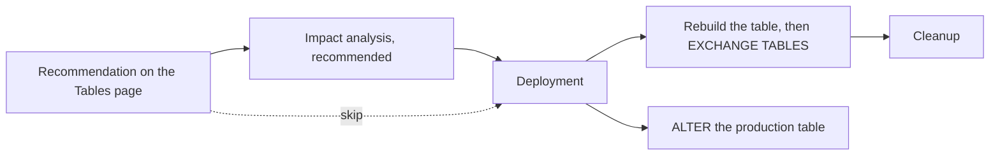

import { PrivatePreviewBadge } from '/snippets/fr/components/PrivatePreviewBadge/PrivatePreviewBadge.jsx';

<PrivatePreviewBadge />

Schema Advisor vous aide à migrer votre schéma dans ClickHouse Cloud, de la recommandation jusqu’au déploiement que vous approuvez, en passant par une analyse d’impact sur un échantillon de vos données.

Dans ClickHouse, le schéma détermine la manière dont une table est stockée : la clé primaire, la clé `ORDER BY`, la compression, les index et les projections. Une clé `ORDER BY` mieux choisie peut transformer un parcours complet de la table en une lecture de quelques granules,
et un codec de compression mieux adapté peut réduire l’espace de stockage occupé par une table.
Appliquer une telle modification à une table de production exige un plan, une validation de ce plan et un déploiement avec le moins de temps d’indisponibilité possible.

Schema Advisor vous accompagne dans cette démarche. Les recommandations sont issues de vos journaux de requêtes dans la section [supervision](/fr/products/cloud/features/monitoring/recommendations#schema-recommendations) ; elles reposent sur des tests déterministes et ne sont pas générées par l’IA.
Si vous souhaitez appliquer ces recommandations, Schema Advisor vous propose un plan pour y parvenir.
Un flux de travail durable exécute le SQL, et vous approuvez chaque étape avant que le flux de travail ne se poursuive.

<Warning>
  Schema Advisor est une fonctionnalité en préversion. Elle est susceptible d’évoluer et n’est pas couverte par le SLA standard de ClickHouse Cloud.
</Warning>

## Demander l’accès {#request-access}

Schema Advisor est disponible dans ClickHouse Cloud. Cette préversion n’inclut ni [Bring Your Own Cloud (BYOC)](/fr/cloud/reference/byoc/overview) ni [ClickHouse Private](/fr/cloud/infrastructure/clickhouse-private).

<Steps>
  <Step title="Ouvrir les fonctionnalités en préversion">
    Connectez-vous à la Console Cloud, sélectionnez votre organisation, puis ouvrez **Fonctionnalités en préversion** depuis le menu de l’organisation. Pour en savoir plus, consultez [Préversions en libre-service](/fr/products/cloud/features/self-service-previews).
  </Step>

  <Step title="Demander l’accès à Schema Advisor">
    Recherchez **Schema Advisor**, sélectionnez **Learn more**, puis **Request access**. Nous vous enverrons un e-mail dès que l’accès sera activé.
    Certaines préversions ne sont pas visibles pour toutes les organisations. Si Schema Advisor n’apparaît pas dans la liste, contactez l’[Assistance Cloud](https://clickhouse.com/support/program).
  </Step>
</Steps>

## Comment une modification se propage {#how-a-change-moves}

L&#39;analyse d&#39;impact est facultative, mais vivement recommandée. Si vous faites confiance à la recommandation, vous pouvez passer directement au déploiement de la modification du schéma.
Sinon, lancez d&#39;abord l&#39;analyse d&#39;impact afin de mesurer l&#39;effet de la modification sur vos requêtes avant toute intervention sur la table de production.

## Partir d’une recommandation {#start-from-a-recommendation}

Une fois que votre organisation y a accès, ouvrez un service et accédez à [**Supervision**](/fr/products/cloud/features/monitoring/cloud-console), puis à **Tables**.
Schema Advisor affiche la recommandation pour une table ainsi que les requêtes qui l’ont générée. Consultez [Query insights](/fr/products/cloud/features/sql-console-features/query-insights) pour accéder au journal des requêtes sur lequel reposent ces recommandations.
Lorsque vous êtes prêt à appliquer la recommandation, cliquez sur **Generate Implementation Plan** en bas de la page de recommandation.
C’est sur la page Tables que se trouvent la recommandation et les plans de mise en œuvre. Vous pouvez toujours revenir sur cette page pour reprendre la mise en œuvre, ou poursuivre la conversation dans ClickHouse Assistant.

Si vous savez quelle modification de schéma vous souhaitez effectuer et qu’elle n’est pas proposée pour cette table, vous pouvez partir de ClickHouse Assistant.
Décrivez la modification et demandez à Schema Advisor de vous guider.
Par exemple : « Je souhaite modifier la clé primaire de ma table default.sales&#95;analysis. Utilise Schema Advisor pour m’aider à le faire. »

Vous pouvez également demander des recommandations à ClickHouse Assistant. Il vérifiera d’abord si des recommandations déterministes ont déjà été formulées,
puis effectuera une analyse ad hoc pour en proposer d’autres.
Nous vous recommandons vivement d’effectuer une analyse d’impact avant de déployer les recommandations générées par le LLM.

## Analyse d&#39;impact {#impact-analysis}

Schema Advisor élabore un plan et affiche le SQL de chaque étape. Une fois le plan approuvé, le flux de travail s&#39;exécute.

1. Nous prélevons un échantillon de la table de production, qui sert de table de référence. Actuellement, cet échantillon compte 10,000,000 lignes.
2. En lisant la table de référence, nous construisons une table candidate dotée du schéma proposé.
3. Nous rejouons 3 fois, sur la table de référence et sur la table candidate, les requêtes les plus fréquemment exécutées sur cette table de production.
4. Les résultats présentent ces exécutions côte à côte, avec une moyenne calculée sur l&#39;ensemble des requêtes. Les métriques comparées sont : le temps d&#39;exécution des requêtes, le nombre de lignes parcourues et le volume de données lues.

Vous pouvez choisir où l&#39;analyse s&#39;exécute :

* **Dans le service actuel.** L&#39;analyse utilise le service dans lequel vous vous trouvez déjà.
* **Dans un service isolé.** Schema Advisor crée un service éphémère distinct, restauré à partir de votre dernière sauvegarde. Pour utiliser cette option, vous devez avoir configuré des sauvegardes.
  Les requêtes d&#39;évaluation des performances s&#39;exécutent sur cette copie des données. Ce fonctionnement diffère de celui d&#39;un [entrepôt](/fr/products/cloud/features/infrastructure/warehouses), dans lequel les services partagent le même stockage.

## Déployer une modification {#deploy-a-change}

Si les résultats de l&#39;analyse d&#39;impact vous conviennent, vous pouvez ensuite déployer la modification. Sinon, vous pouvez ignorer la recommandation. L&#39;exécution varie selon le type de modification.

* **Reconstruction complète de la table.** Ces modifications de schéma nécessitent une reconstruction complète : modification de l&#39;ordre de tri ou de la clé primaire.
  Schema Advisor crée la nouvelle table, copie les données, vérifie la copie, puis la met en place par un swap avec [`EXCHANGE TABLES`](/fr/sql-reference/statements/exchange).
  L&#39;échange étant atomique, le nom de production pointe vers la nouvelle table sans aucun temps d&#39;indisponibilité.
  Schema Advisor affiche le statement exact, que le flux de travail exécute une fois que vous l&#39;avez approuvé.
  Après le swap, l&#39;ancienne table n&#39;est pas supprimée automatiquement. Le [nettoyage](#cleanup) ne s&#39;exécute que lorsque vous cliquez sur le bouton.
* **`ALTER TABLE`.** Ces modifications s&#39;appliquent sur place, sans reconstruction ni `EXCHANGE TABLES`. Il s&#39;agit notamment de l&#39;ajout d&#39;un index ou d&#39;une projection.
  Schema Advisor affiche le statement `ALTER` exact. Une fois que vous l&#39;avez approuvé, le flux de travail exécute ce statement sur la table de production.

## Nettoyage {#cleanup}

Après une reconstruction complète de la table, l&#39;ancienne table est conservée comme sauvegarde. Le nettoyage n&#39;a lieu que lorsque vous cliquez sur le bouton **Clean up**.
Schema Advisor supprime alors toutes les tables de sauvegarde existantes ainsi que tous les services éphémères.

## Modèles et traitement des données {#models-and-data-handling}

Par défaut, les appels aux modèles effectués par Schema Advisor transitent par la ClickHouse Inference Gateway sur Amazon Bedrock.

Nous n’entraînons aucun modèle sur vos données. Les seules informations transmises au modèle sont les métadonnées de votre schéma de table ainsi que la recommandation.

## Limitations {#limitations}

Dans le cadre de cet aperçu privé, le déploiement d’une modification nécessitant une reconstruction complète de la table n’est pas possible dans les cas suivants :

* La table ingère des données en continu.
* La table contient plus de 100 millions de lignes ou dépasse 100 Go, selon la limite atteinte en premier. Vous pouvez néanmoins élaborer un plan et exécuter une analyse d’impact.
* La table a des dépendances en aval, notamment des [vues matérialisées](/fr/materialized-views).

## Pages connexes {#related-pages}

* [Supervision dans la Console Cloud](/fr/products/cloud/features/monitoring/cloud-console)
* [Query insights](/fr/products/cloud/features/sql-console-features/query-insights)
* [Entrepôts](/fr/products/cloud/features/infrastructure/warehouses)
* [Conception de schéma](/fr/data-modeling/schema-design)
* [Préversions en libre-service](/fr/products/cloud/features/self-service-previews)
* [`EXCHANGE`](/fr/sql-reference/statements/exchange)