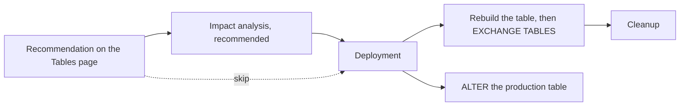

import { PrivatePreviewBadge } from '/snippets/ja/components/PrivatePreviewBadge/PrivatePreviewBadge.jsx';

<PrivatePreviewBadge />

Schema Advisor は、ClickHouse Cloud でのスキーマ移行を支援します。推奨事項の提示から、データのサンプルを用いた影響分析、お客様の承認によるデプロイまでを一貫してサポートします。

ClickHouse では、スキーマによってテーブルの保存方法が決まります。具体的には、主キー、`ORDER BY` キー、圧縮、索引、プロジェクションです。`ORDER BY` を改善すれば、フルテーブルスキャンを数個のグラニュールの読み取りで済ませられるようになり、
より適切な圧縮コーデックを使えば、テーブルが使用するストレージを削減できます。
本番テーブルでこうした変更を行うには、実行計画を立て、その実行計画を検証したうえで、ダウンタイムを最小限に抑えたロールアウトを行う必要があります。

Schema Advisor は、こうした作業を支援します。推奨事項は、[監視](/ja/products/cloud/features/monitoring/recommendations#schema-recommendations)のクエリログをもとに、AI による生成ではなく決定論的なテストに基づいて導き出されます。
これらの推奨事項を適用したい場合は、Schema Advisor がそのための実行計画を提案します。
永続的なワークフローが SQL を実行し、各ステップはお客様の承認を経てから次に進みます。

<Warning>
  Schema Advisor はプレビュー機能です。今後変更される可能性があり、ClickHouse Cloud の標準 SLA の対象外です。
</Warning>

## アクセスをリクエストする {#request-access}

Schema Advisor は ClickHouse Cloud で利用できます。このプレビューには [Bring Your Own Cloud (BYOC)](/ja/cloud/reference/byoc/overview) および [ClickHouse Private](/ja/cloud/infrastructure/clickhouse-private) は含まれません。

<Steps>
  <Step title="プレビュー機能を開く">
    クラウドコンソールにサインインして組織を選択し、組織メニューから **プレビュー機能** を開きます。詳しくは [セルフサービスプレビュー](/ja/products/cloud/features/self-service-previews) を参照してください。
  </Step>

  <Step title="Schema Advisor へのアクセスをリクエストする">
    **Schema Advisor** を探して **Learn more** を選択し、続けて **Request access** を選択します。アクセスが有効になり次第、メールでお知らせします。
    組織によっては、一部のプレビューが表示されない場合があります。一覧に Schema Advisor が表示されない場合は、[Cloud サポート](https://clickhouse.com/support/program)までお問い合わせください。
  </Step>
</Steps>

## 変更が伝播する仕組み {#how-a-change-moves}

影響分析は任意ですが、実施を強く推奨します。推奨内容を信頼できる場合は、影響分析を省略してスキーマ変更のデプロイに進んでも構いません。
そうでない場合は、本番テーブルに手を加える前にまず影響分析を実行し、変更がクエリにどのような影響を及ぼすかを確認してください。

## 推奨事項から始める {#start-from-a-recommendation}

組織でアクセスが有効になったら、サービスを開いて [**監視**](/ja/products/cloud/features/monitoring/cloud-console) に移動し、**Tables** を選択します。
Schema Advisor には、テーブルに対する推奨事項と、その推奨事項の根拠となったクエリが表示されます。推奨事項の基になっているクエリログについては、[クエリインサイト](/ja/products/cloud/features/sql-console-features/query-insights) を参照してください。
推奨事項を適用する準備ができたら、推奨事項ページの下部にある **Generate Implementation Plan** をクリックします。
推奨事項と実装計画は Tables ページで管理されます。いつでもこのページに戻って実装を再開したり、ClickHouse Assistant で会話を続けたりできます。

行いたいスキーマ変更が決まっているものの、そのテーブルに表示されていない場合は、ClickHouse Assistant から始めることもできます。
変更内容を説明し、Schema Advisor による手順の案内を依頼してください。
例: 「テーブル default.sales&#95;analysis の主キーを変更したいです。Schema Advisor を使って手伝ってください。」

ClickHouse Assistant に推奨事項を尋ねることもできます。Assistant はまず決定論的な推奨事項がすでに作成されているかを確認し、
さらにアドホックな分析を行って追加の推奨事項を提示します。
LLM が生成した推奨事項をデプロイする前に、影響分析を実行することを強く推奨します。

## 影響分析 {#impact-analysis}

Schema Advisor は実行計画を作成し、各ステップの SQL を表示します。承認すると、ワークフローが実行されます。

1. 本番テーブルのサンプルを取得し、ベースラインテーブルとして使用します。現在のサンプルサイズは 10,000,000 行です。
2. ベースラインからデータを読み取り、提案されたスキーマで候補テーブルを作成します。
3. その本番テーブルで最も頻繁に実行されるクエリを、ベースラインテーブルと候補テーブルのそれぞれに対して 3 回再適用します。
4. 結果画面では、これらの実行結果がクエリ全体で平均化され、並べて表示されます。比較するメトリクスは、クエリ実行時間、スキャン行数、読み取りデータ量です。

分析の実行場所は、次のいずれかから選択できます。

* **現在のサービス内。** 現在使用しているサービスで分析を実行します。
* **分離されたサービス内。** Schema Advisor が、最新のバックアップから復元した一時的なサービスを別途作成します。この方法を使用するには、バックアップを設定しておく必要があります。
  ベンチマーク測定用のクエリは、このデータのコピー上で実行されます。これは、複数のサービスが同じストレージを共有する [warehouse](/ja/products/cloud/features/infrastructure/warehouses) とは異なる仕組みです。

## 変更をデプロイする {#deploy-a-change}

影響分析の結果に問題がなければ、そのままデプロイできます。問題がある場合は、推奨事項を却下できます。実行される処理は、変更の種別によって異なります。

* **テーブルの完全な再構築。** ソート順や主キーの変更といったスキーマ変更には、完全な再構築が必要です。
  Schema Advisor は新しいテーブルを作成してデータをコピーし、コピー内容をチェックした後、[`EXCHANGE TABLES`](/ja/sql-reference/statements/exchange) を使用して元のテーブルと入れ替えます。
  この入れ替えはアトミックに行われるため、本番環境のテーブル名はダウンタイムなしで新しいテーブルを指すようになります。
  Schema Advisor は実行されるステートメントをそのまま表示し、承認するとワークフローがそれを実行します。
  入れ替え後も、古いテーブルは自動的には削除されません。[クリーンアップ](#cleanup)は、ボタンをクリックした場合にのみ実行されます。
* **`ALTER TABLE`。** これらの変更はインプレースで適用され、再構築も `EXCHANGE TABLES` も行われません。索引やプロジェクションの追加などがこれに該当します。
  Schema Advisor は実行される `ALTER` ステートメントをそのまま表示します。承認すると、ワークフローがそのステートメントを本番テーブルに対して実行します。

## クリーンアップ {#cleanup}

テーブル全体を再構築した後も、古いテーブルはバックアップとして残ります。**Clean up** ボタンをクリックするまで、クリーンアップは実行されません。
ボタンをクリックすると、Schema Advisor は既存のバックアップテーブルと一時的なサービスをすべて削除します。

## モデルとデータの取り扱い {#models-and-data-handling}

デフォルトでは、Schema Advisor からのモデル呼び出しは、Amazon Bedrock 上の ClickHouse Inference Gateway を経由して行われます。

お客様のデータがモデルのトレーニングに使用されることはありません。モデルに送信される情報は、テーブルスキーマに関するメタデータと推奨内容のみです。

## 制限事項 {#limitations}

このプライベートプレビューでは、次のいずれかに該当する場合、テーブルの完全な再構築を伴う変更はデプロイできません。

* テーブルが継続的にデータを取り込んでいる場合。
* テーブルの行数が 1 億行を超える場合、またはサイズが 100 GB を超える場合 (いずれか先に達した上限が適用されます) 。この場合でも、実行計画の作成と影響分析の実行は可能です。
* テーブルに [materialized view](/ja/materialized-views) などの下流の依存関係がある場合。

## 関連ページ {#related-pages}

* [クラウドコンソールでの監視](/ja/products/cloud/features/monitoring/cloud-console)
* [クエリインサイト](/ja/products/cloud/features/sql-console-features/query-insights)
* [Warehouses](/ja/products/cloud/features/infrastructure/warehouses)
* [スキーマ設計](/ja/data-modeling/schema-design)
* [セルフサービスプレビュー](/ja/products/cloud/features/self-service-previews)
* [`EXCHANGE`](/ja/sql-reference/statements/exchange)