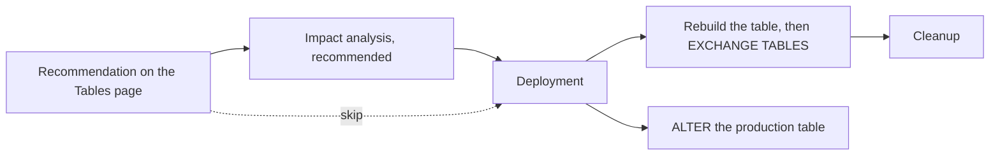

import { PrivatePreviewBadge } from '/snippets/ko/components/PrivatePreviewBadge/PrivatePreviewBadge.jsx';

<PrivatePreviewBadge />

Schema Advisor는 ClickHouse Cloud에서 스키마(schema)를 마이그레이션하는 전 과정을 지원합니다. 권장 사항에서 출발해 데이터 표본(sample)을 대상으로 한 영향 분석을 거쳐, 사용자가 승인한 배포에 이르기까지 함께합니다.

ClickHouse에서는 스키마가 테이블의 저장 방식을 결정합니다. 여기에는 프라이머리 키, `ORDER BY` 키, 압축, 인덱스(indexes), 프로젝션이 포함됩니다. `ORDER BY`를 개선하면 전체 테이블 스캔을 그래뉼 몇 개만 읽는 작업으로 줄일 수 있으며,
더 적합한 압축 코덱을 사용하면 테이블이 차지하는 스토리지를 줄일 수 있습니다.
프로덕션 테이블에 이러한 변경을 적용하려면 계획을 세우고, 해당 계획에 대한 유효성 검사를 거친 뒤, 서비스 중단 시간을 최소화하면서 롤아웃해야 합니다.

Schema Advisor는 이 작업을 돕습니다. 권장 사항은 [모니터링](/ko/products/cloud/features/monitoring/recommendations#schema-recommendations)의 쿼리 로그(query logs)를 바탕으로 하며, AI가 생성한 것이 아니라 결정적 테스트를 통해 도출됩니다.
이러한 권장 사항을 적용하려는 경우 Schema Advisor가 이를 위한 계획을 제안합니다.
내구성 있는(durable) 워크플로가 SQL을 실행하며, 각 단계는 사용자가 승인해야 워크플로가 다음 단계로 진행됩니다.

<Warning>
  Schema Advisor는 프리뷰 기능입니다. 향후 변경될 수 있으며, 표준 ClickHouse Cloud SLA가 적용되지 않습니다.
</Warning>

## 액세스 요청 {#request-access}

Schema Advisor는 ClickHouse Cloud에서 사용할 수 있습니다. 이 프리뷰는 [자체 클라우드 사용(Bring Your Own Cloud, BYOC)](/ko/cloud/reference/byoc/overview) 및 [ClickHouse Private](/ko/cloud/infrastructure/clickhouse-private)를 지원하지 않습니다.

<Steps>
  <Step title="프리뷰 기능 열기">
    클라우드 콘솔에 로그인하여 조직을 선택한 다음, 조직 메뉴에서 **프리뷰 기능**을 여십시오. 자세한 내용은 [셀프서비스 프리뷰](/ko/products/cloud/features/self-service-previews)를 참고하십시오.
  </Step>

  <Step title="Schema Advisor 액세스 요청">
    **Schema Advisor**를 찾아 **자세히 알아보기**를 선택한 다음 **액세스 요청**을 선택하십시오. 액세스가 활성화되면 이메일로 알려 드립니다.
    일부 조직에는 특정 프리뷰가 표시되지 않을 수 있습니다. 목록에 Schema Advisor가 없으면 [Cloud 지원팀](https://clickhouse.com/support/program)에 문의하십시오.
  </Step>
</Steps>

## 변경 사항이 전파되는 과정 {#how-a-change-moves}

영향 분석은 선택 사항이지만 수행할 것을 적극 권장합니다. 권장 사항을 신뢰한다면 영향 분석을 건너뛰고 바로 스키마(schema) 변경 배포 단계로 넘어가도 됩니다.
그렇지 않다면 프로덕션 테이블에 변경이 적용되기 전에 먼저 영향 분석을 실행하여 해당 변경이 쿼리에 어떤 영향을 미치는지 확인하십시오.

## 권장 사항에서 시작하기 {#start-from-a-recommendation}

조직에 액세스 권한이 부여되면 서비스를 열고 [**모니터링**](/ko/products/cloud/features/monitoring/cloud-console)으로 이동한 다음 **Tables**를 선택하십시오.
Schema Advisor는 테이블에 대한 권장 사항과 해당 권장 사항의 근거가 된 쿼리를 표시합니다. 권장 사항의 기반이 되는 쿼리 로그(query log)에 대해서는 [쿼리 인사이트](/ko/products/cloud/features/sql-console-features/query-insights)를 참조하십시오.
권장 사항을 적용할 준비가 되면 권장 사항 페이지 하단의 **Generate Implementation Plan**을 클릭하십시오.
권장 사항과 구현 계획은 Tables 페이지에서 관리됩니다. 언제든지 이 페이지로 돌아와 구현을 이어서 진행하거나 ClickHouse Assistant에서 대화를 이어갈 수 있습니다.

원하는 스키마(schema) 변경 사항이 이미 정해져 있지만 해당 테이블에 표시되지 않는다면 ClickHouse Assistant에서 시작할 수 있습니다.
변경하려는 내용을 설명하고 Schema Advisor에 작업 안내를 요청하십시오.
예시: &quot;default.sales&#95;analysis 테이블의 프라이머리 키를 변경하고 싶습니다. Schema Advisor를 사용하여 이 작업을 도와주세요.&quot;

ClickHouse Assistant에 권장 사항을 요청할 수도 있습니다. Assistant는 먼저 이미 생성된 결정적 권장 사항이 있는지 확인한 뒤,
임시(ad hoc) 분석을 추가로 수행하여 더 많은 권장 사항을 제공합니다.
LLM이 생성한 권장 사항을 배포하기 전에 영향 분석을 실행할 것을 적극 권장합니다.

## 영향 분석 {#impact-analysis}

Schema Advisor는 계획을 수립하고 각 단계의 SQL을 보여줍니다. 승인하면 워크플로가 실행됩니다.

1. 프로덕션 테이블의 표본(sample)을 기준값 테이블로 사용합니다. 현재 표본 크기는 10,000,000개 행(rows)입니다.
2. 기준값 테이블에서 데이터를 읽어 제안된 스키마(schema)로 후보 테이블을 빌드합니다.
3. 해당 프로덕션 테이블에서 가장 자주 실행되는 쿼리를 기준값 테이블과 후보 테이블에서 각각 3회씩 재적용합니다.
4. 결과(result)에는 각 실행 결과가 쿼리 전체의 평균값으로 나란히 표시됩니다. 비교하는 메트릭은 쿼리 시간, 스캔한 행 수, 읽은 데이터 양입니다.

분석을 실행할 위치는 다음 중에서 선택할 수 있습니다.

* **현재 서비스에서 실행.** 현재 사용 중인 서비스에서 분석을 수행합니다.
* **격리된 서비스에서 실행.** Schema Advisor가 최신 백업에서 복원한 별도의 일시적 서비스를 생성합니다. 이 옵션을 사용하려면 백업이 설정되어 있어야 합니다.
  벤치마킹 쿼리는 이 데이터 사본에서 실행됩니다. 이는 여러 서비스가 동일한 저장소를 공유하는 [웨어하우스(warehouse)](/ko/products/cloud/features/infrastructure/warehouses)와는 다른 방식입니다.

## 변경 사항 배포 {#deploy-a-change}

영향 분석 결과가 만족스러우면 이어서 배포할 수 있습니다. 그렇지 않으면 권장 사항을 무시할 수 있습니다. 실행 방식은 변경 유형에 따라 다릅니다.

* **전체 테이블 재구성.** 정렬 순서(sort order)나 프라이머리 키를 변경하는 스키마 변경(schema changes)은 전체 재구성이 필요합니다.
  Schema Advisor는 새 테이블을 생성하고 데이터를 복사한 뒤 복사본을 검사하고, [`EXCHANGE TABLES`](/ko/sql-reference/statements/exchange)를 사용하여 기존 테이블과 스왑합니다.
  이 교환은 원자적으로 수행되므로 서비스 중단 시간 없이 프로덕션 테이블 이름이 새 테이블을 가리키게 됩니다.
  Schema Advisor는 실행될 SQL 문을 그대로 표시하며, 사용자가 승인하면 워크플로가 해당 SQL 문을 실행합니다.
  스왑 후에도 기존 테이블은 자동으로 삭제되지 않습니다. [정리](#cleanup)는 사용자가 버튼을 클릭해야만 실행됩니다.
* **`ALTER TABLE`.** 인덱스나 프로젝션(projection) 추가와 같은 변경 사항은 재구성이나 `EXCHANGE TABLES` 없이 기존 테이블에 바로 적용됩니다.
  Schema Advisor는 실행될 `ALTER` SQL 문을 그대로 표시합니다. 사용자가 승인하면 워크플로가 해당 SQL 문을 프로덕션 테이블에 실행합니다.

## 정리 {#cleanup}

테이블 전체를 재구성하면 기존 테이블은 백업(backup)으로 남습니다. **Clean up** 버튼을 클릭해야 정리가 실행됩니다.
버튼을 클릭하면 Schema Advisor가 기존 백업 테이블과 일시적 서비스를 모두 삭제합니다.

## 모델 및 데이터 처리 {#models-and-data-handling}

기본적으로 Schema Advisor의 모델 호출은 Amazon Bedrock 기반의 ClickHouse Inference Gateway를 통해 처리됩니다.

ClickHouse는 사용자 데이터를 모델 학습에 사용하지 않습니다. 모델에 전송되는 정보는 테이블 스키마(table schema)에 대한 메타데이터와 권장 사항뿐입니다.

## 제한 사항 {#limitations}

이 비공개 프리뷰에서는 다음과 같은 경우 전체 테이블 재구성 변경을 배포할 수 없습니다.

* 테이블에 데이터가 지속적으로 수집되는 경우
* 테이블의 행(rows) 수가 1억 개를 초과하거나 크기가 100 GB를 초과하는 경우(둘 중 먼저 도달하는 기준 적용). 이 경우에도 계획을 생성하고 영향 분석을 실행할 수는 있습니다.
* 테이블에 [materialized view](/ko/materialized-views)를 비롯한 다운스트림 의존성이 있는 경우

## 관련 페이지 {#related-pages}

* [클라우드 콘솔의 모니터링](/ko/products/cloud/features/monitoring/cloud-console)
* [쿼리 인사이트](/ko/products/cloud/features/sql-console-features/query-insights)
* [웨어하우스(warehouse)](/ko/products/cloud/features/infrastructure/warehouses)
* [스키마(schema) 설계](/ko/data-modeling/schema-design)
* [셀프서비스 프리뷰](/ko/products/cloud/features/self-service-previews)
* [`EXCHANGE`](/ko/sql-reference/statements/exchange)