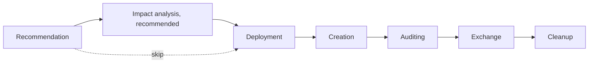

import { PrivatePreviewBadge } from '/snippets/components/PrivatePreviewBadge/PrivatePreviewBadge.jsx';

<PrivatePreviewBadge />

Schema Advisor moves a schema recommendation through an optional impact analysis to a deployment you approve. In this private preview it works on one [`MergeTree`](/engines/table-engines/mergetree-family/mergetree) table at a time.

It can deploy five kinds of change: the sorting key, the partition key, column types, compression codecs, and combinations of those. Creating a materialized view, a projection, or an index is not supported yet.

[Recommendations](/products/cloud/features/monitoring/recommendations) come from deterministic tests on your query logs. The model does not invent the recommendation, and it does not run SQL. It proposes a plan. A durable workflow runs the SQL. You see each statement and approve it before the workflow continues. [`EXCHANGE TABLES`](/sql-reference/statements/exchange) and `DROP TABLE` are templates, not statements the model writes.

<Warning>
Schema Advisor is a preview feature. It may change, and it is not covered by the standard ClickHouse Cloud SLA.
</Warning>

## Request access {#request-access}

Schema Advisor is available in ClickHouse Cloud. This preview does not include [Bring Your Own Cloud (BYOC)](/cloud/reference/byoc/overview) or [ClickHouse Private](/cloud/infrastructure/clickhouse-private).

In this preview, only an organization admin can use Schema Advisor. Access for other roles is planned.

<Steps>

<Step title="Open Preview features">

Sign in to the Cloud console, select your organization, and open **Preview features** from the organization menu. See [Self-service previews](/products/cloud/features/self-service-previews).

</Step>

<Step title="Request access to Schema Advisor">

Find **Schema Advisor**, select **Learn more**, and then select **Request access**. We will email you when access is turned on.

</Step>

</Steps>

Some previews are hidden for some organizations. Contact [Cloud Support](https://clickhouse.com/support/program) if Schema Advisor is missing from the list.

## What you need {#what-you-need}

- **An organization admin.** Other roles cannot open Schema Advisor in this preview.
- **A service to run against.** Schema Advisor can use a service that also serves other work. A dedicated service is recommended, so the preview stays off production traffic.
- **A sandbox database on that service.** Impact analysis builds its tables there. A separate service used only for the analysis is not available in this preview.

## How a change moves {#how-a-change-moves}

Impact analysis is optional and recommended. Skipping it means you deploy without a measured comparison. The new table is then built at the exchange step, instead of during the analysis.

## Start from a recommendation {#start-from-a-recommendation}

You can start from a recommendation, or describe a change yourself.

1. **Tables.** Open a service, go to [**Monitoring**](/products/cloud/features/monitoring/cloud-console), then **Tables**, and open the recommendation. The queries that produced it are on that page. Select **Generate implementation plan** at the bottom of the page.
2. **SQL console.** Right-click the table name and select **Optimize table schema**.
3. **Assistant.** Open [Assistant](/agents/assistant/using-ai-chat) with the sparkle button in the top right. Older consoles put Assistant in the left sidebar. This is not ClickHouse Agents. In the Assistant tools, enable **Manage Schema Changes**. You can paste the change you want and ask Schema Advisor to carry it out. A change you describe yourself can be less accurate than a recommendation from query history.

Schema Advisor then asks whether to run impact analysis or go straight to deployment, and generates the plan. The run, including the chat, is listed under **Runs** on the Tables page.

## Impact analysis {#impact-analysis}

After you choose which recommendations to apply, impact analysis checks the change before production is touched.

Schema Advisor writes a plan that builds two tables from a sample, in the sandbox database:

1. A **baseline** with the current schema.
2. A **candidate** with the proposed schema.

It replays the queries that run most often on that table, or the queries that produced the recommendation, once on each table. It shows those runs side by side.

The comparison is a sample, and it covers those queries only. It is not a measurement of the full table. The queries come from [`system.query_log`](/operations/system-tables/query_log). You cannot supply your own benchmark queries in this preview.

You can approve the plan, modify it, or abandon it. The sandbox does not run until you approve.

## Deploy a change {#deploy-a-change}

Deployment is a blue-green cutover in four stages. Data is copied partition by partition. The production name changes only after you approve the swap.

1. **Creation.** Schema Advisor creates the new table and copies the data. If you skipped impact analysis, this build happens when you approve the exchange.
2. **Auditing.** Row counts, checksums, and the schema are checked against the source. The swap waits until you approve it.
3. **Exchange.** You approve [`EXCHANGE TABLES`](/sql-reference/statements/exchange). The exchange is atomic, so the production name points at the new table. The previous table is kept as a backup.
4. **Cleanup.** The backup table stays until you approve `DROP TABLE`.

The exchange and the drop are templates. The workflow shows the statement and runs it only after you approve it.

Running impact analysis and deployment uses compute on the service. There is no separate charge for Schema Advisor. This does not change the service's scaling or idling settings. Generating the recommendation does not use service compute.

## Approval gates {#approval-gates}

Nothing destructive runs without an explicit click. Each gate shows the SQL first.

| Gate | What you decide | What is already true |
| --- | --- | --- |
| Choose recommendations | Which recommendations to apply. | The table and its workload have been inspected. |
| Run the impact-analysis plan | Approve the sandbox plan, modify it, or abandon it. | The plan has been generated and checked. |
| Continue to production | Deploy, or stop after the benchmark. | The sandbox run has finished. |
| Exchange | Approve `EXCHANGE TABLES` on the production table. | When impact analysis ran first, the data has been copied and the row counts, checksums, and schema have been checked. When it did not, the new table is built at this step. |
| Clean up | Approve dropping the backup table. | The exchange succeeded. The backup table is kept until you drop it. |

## What the workflow is allowed to do {#what-the-workflow-is-allowed-to-do}

- **A dedicated database user.** The user can write only in the sandbox database. It can read system tables and production databases. It has no other write access to production.
- **Approval for destructive statements.** `EXCHANGE TABLES`, `DROP TABLE`, and any repair step wait for a click. The SQL is shown first.
- **A check on generated SQL.** Statements outside the supported change set are blocked, and generated SQL is reviewed before it can run.
- **Admins only.** Other roles cannot use the preview yet.

## Models and data handling {#models-and-data-handling}

Model calls from Schema Advisor go through the ClickHouse Inference Gateway on Amazon Bedrock. Your data stays within AWS security and privacy controls, and ClickHouse applies its own safeguards on top. See [AI compliance](/cloud/security/ai-compliance) for how ClickHouse Cloud handles data used by AI features.

## Limitations {#limitations}

In this private preview:

- Schema Advisor changes one `MergeTree` table at a time.
- The supported changes are the sorting key, the partition key, column types, compression codecs, and combinations of those. Materialized views, projections, and indexes are not created.
- Tables with downstream dependencies, including [materialized views](/materialized-views), are out of scope.
- Tables with continuous ingestion, or tables that update rapidly, are a poor fit. Rows that arrive during the copy can be missing from the new table.
- Deployment is unavailable when the table has more than 100 million rows, or is larger than 100 GiB, whichever limit it reaches first. You can still build a plan and run impact analysis.
- There is no public API. The preview runs in the console.
- There is no notification when a long operation finishes.
- There is no deployment history. Statements that ran are in `system.query_log`.
- If Schema Advisor cannot create the table, start the flow again.

## Related pages {#related-pages}

- [Query and schema recommendations](/products/cloud/features/monitoring/recommendations)
- [Monitoring in the Cloud console](/products/cloud/features/monitoring/cloud-console)
- [Query insights](/products/cloud/features/sql-console-features/query-insights)
- [Schema design](/data-modeling/schema-design)
- [Assistant](/agents/assistant/using-ai-chat)
- [Self-service previews](/products/cloud/features/self-service-previews)
- [`EXCHANGE`](/sql-reference/statements/exchange)
