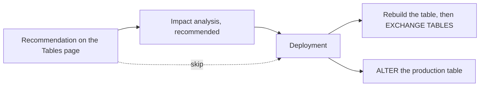

import { PrivatePreviewBadge } from '/snippets/components/PrivatePreviewBadge/PrivatePreviewBadge.jsx';

<PrivatePreviewBadge />

Schema Advisor helps you migrate your schema in ClickHouse Cloud from a recommendation, through an impact analysis on a sample of your data, to a deployment you approve. 

In ClickHouse, the schema decides how a table is stored: the primary key, the `ORDER BY` key, compression, indexes, and projections. A better `ORDER BY` can turn a full table scan into a read of a few granules, 
and a better compression codec can cut the storage a table uses. 
Making that change on a production table requires that you have a plan, validation on the plan, and a rollout with as little downtime as possible.

Schema Advisor helps you with that work. Recommendations come from your query logs in [Monitoring](/products/cloud/features/monitoring/recommendations#schema-recommendations), based on deterministic tests, not AI-generated.
If you want to action those recommendations, then Schema Advisor proposes the plan to help you get there.
A durable workflow executes the SQL and you approve each step before the workflow continues.

<Warning>
Schema Advisor is a preview feature. It may change, and it is not covered by the standard ClickHouse Cloud SLA.
</Warning>

## Request access {#request-access}

Schema Advisor is available in ClickHouse Cloud. This preview does not include [Bring Your Own Cloud (BYOC)](/cloud/reference/byoc/overview) or [ClickHouse Private](/cloud/infrastructure/clickhouse-private).

<Steps>

<Step title="Open Preview features">

Sign in to the Cloud console, select your organization, and open **Preview features** from the organization menu. See [Self-service previews](/products/cloud/features/self-service-previews).

</Step>

<Step title="Request access to Schema Advisor">

Find **Schema Advisor**, select **Learn more**, and then select **Request access**. We will email you when access is turned on. 
Some previews are hidden for some organizations. Contact [Cloud Support](https://clickhouse.com/support/program) if Schema Advisor is missing from the list.

</Step>

</Steps>

## How a change moves {#how-a-change-moves}

Impact analysis is optional but highly recommended. If you trust the recommendation, you can skip ahead to deploying the schema change. 
Else, run impact analysis first so you can see what the change does to your queries before anything touches the production table.

## Start from a recommendation {#start-from-a-recommendation}

After your organization has access, open a service and go to [**Monitoring**](/products/cloud/features/monitoring/cloud-console), then **Tables**. 
Schema Advisor shows the recommendation for a table and the queries that produced it. See [Query insights](/products/cloud/features/sql-console-features/query-insights) for the query log those recommendations are based on.
Once you're ready to apply the recommendation, click **Generate implementation plan** at the bottom of the recommendation page.

## Impact analysis {#impact-analysis}

Schema Advisor builds a plan and shows the SQL for every step. After you approve, the workflow executes.

1. We take a sample of the production table as the baseline table. Today that sample size is 10,000,000 rows. 
2. Reading from the baseline, we build a candidate table with the proposed schema.
3. We replay the queries that run most often on that production table with the baseline and candidate tables 3 times.
4. The results are showed those runs side by side, averaged out across the queries. The metrics compared are: query time, rows scanned, and data read.

You can choose where the analysis runs:

- **In the current service.** The analysis uses the service you are already in.
- **In an isolated service.** Schema Advisor creates a separate ephemeral service restored from your latest backup. You must have backups set up to use this. 
The benchmarking queries run on that copy of the data. This is separate from a [warehouse](/products/cloud/features/infrastructure/warehouses), where services share the same storage.

## Deploy a change {#deploy-a-change}

If you like the results of the impact analysis, you can deploy after. Else you can dismiss the recommendation. Depending on the change type, the execution will look different.

- **Full table rebuild.** These schema changes require a full rebuild: changing the sort order, or changing the primary key.
Schema Advisor creates the new table, copies the data, checks the copy, and then swaps it into place with [`EXCHANGE TABLES`](/sql-reference/statements/exchange).
The exchange is atomic, so the production name points at the new table with no downtime.
Schema Advisor shows the exact statement, and the workflow runs it after you approve it.
- **`ALTER TABLE`.** These changes apply in place, with no rebuild and no `EXCHANGE TABLES`. These include adding an index or a projection.
Schema Advisor shows the exact `ALTER` statement. After you approve it, the workflow runs that statement on the production table.

## Models and data handling {#models-and-data-handling}

By default, model calls from Schema Advisor go through the ClickHouse Inference Gateway on Amazon Bedrock.

## Limitations {#limitations}

In this private preview, deployment of a full table rebuild change is unavailable in these cases:

- The table ingests data continuously.
- The table has more than 100 million rows, or is larger than 100 MB, whichever limit it reaches first. You can still build a plan and run impact analysis.
- The table has downstream dependencies, including [materialized views](/materialized-views).

## Related pages {#related-pages}

- [Monitoring in the Cloud console](/products/cloud/features/monitoring/cloud-console)
- [Query insights](/products/cloud/features/sql-console-features/query-insights)
- [Warehouses](/products/cloud/features/infrastructure/warehouses)
- [Schema design](/data-modeling/schema-design)
- [Self-service previews](/products/cloud/features/self-service-previews)
- [`EXCHANGE`](/sql-reference/statements/exchange)
