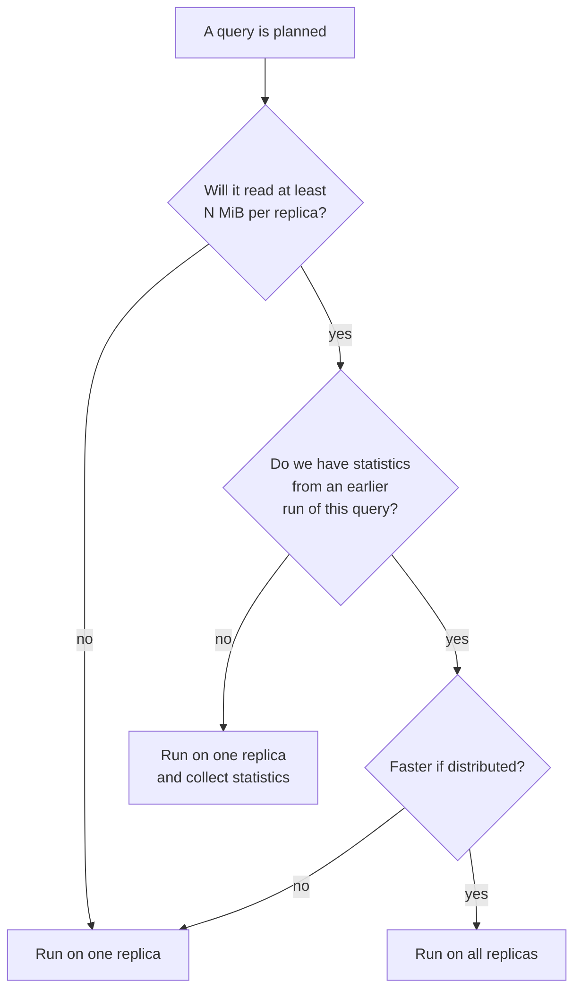

With automatic parallel replicas, ClickHouse decides for each query whether to run it on all replicas
of your service or on a single one. It looks at what earlier runs of the same query read and returned,
and uses [parallel replicas](/deployment-guides/parallel-replicas) only where they are expected to make
the query faster.

This page describes ClickHouse 26.10 and later.

## Why automatic parallel replicas {#why-automatic-parallel-replicas}

In ClickHouse Cloud every replica of a service can read all of its data, but by default a query runs on
the one replica that received it. [Parallel replicas](/deployment-guides/parallel-replicas) let one query
use all replicas at once: each replica reads a share of the data, processes it, and sends its partial
result to the replica that received the query, which combines them.

Whether that pays off depends on the query:

- A query that reads a lot of data and **reduces it to a small result**, such as a query with very
  selective filters or a low-cardinality aggregation, can run several times faster.
- A query that reads little data, or whose replicas have to **send back almost as much as they read**,
  such as a `GROUP BY` over a very high-cardinality column, gets slower: the extra network
  transfer and the final merge cost more than the parallel reading saves.

Turning parallel replicas on with `enable_parallel_replicas = 1` is all-or-nothing: the setting applies to
every query of the user, profile, or session, the ones that get faster and the ones that get slower.
Automatic parallel replicas make the choice per query instead.

## What it does {#what-it-does}

When automatic parallel replicas are enabled:

- The first time a query runs, it runs on one replica as usual. While it runs, ClickHouse collects certain
  execution statistics and remembers them in an in-memory cache.
- The next time the same query runs, ClickHouse compares two estimates, one replica against all replicas,
  and picks the faster one.
- When in doubt, the query runs on one replica, exactly as without the feature. A query is never moved to
  parallel replicas unless the model predicts that it pays off.

You don't change your queries. Queries that would get slower with parallel replicas keep running on one
replica, thus the name "automatic".

<div className="ch-image-lg">

<Frame>


</Frame>

</div>

## Enabling automatic parallel replicas {#enabling-automatic-parallel-replicas}

Automatic parallel replicas build on the regular parallel replicas setup, plus one setting:

```sql
SET enable_parallel_replicas = 1;
SET cluster_for_parallel_replicas = 'default';
SET max_parallel_replicas = 1000;
SET automatic_parallel_replicas_mode = 1;
```

In ClickHouse Cloud, `cluster_for_parallel_replicas` is `default`. `max_parallel_replicas` is the largest
number of replicas a query may use; values above the number of replicas in the service are capped to it.

To enable it for every query of a user, put the settings into a
[settings profile](/sql-reference/statements/create/settings-profile):

```sql
CREATE SETTINGS PROFILE automatic_parallel_replicas SETTINGS
    enable_parallel_replicas = 1,
    cluster_for_parallel_replicas = 'default',
    max_parallel_replicas = 1000,
    automatic_parallel_replicas_mode = 1
TO analyst;
```

### Modes {#modes}

| `automatic_parallel_replicas_mode` | Behavior |
|---|---|
| `0` (default) | Off. `enable_parallel_replicas = 1` uses parallel replicas for every query that supports them. |
| `1` | On. Automatic parallel replicas optimization decides per query. |
| `2` | Statistics are collected, but queries never switch to parallel replicas. It exists for testing purposes, not meant for production use. |

`enable_parallel_replicas = 2` forces parallel replicas for a query and turns the automatic decision off.
Use it for a query that you know benefits from parallel replicas.

To turn the automatic decision off for one query, add `SETTINGS automatic_parallel_replicas_mode = 0` to it.

## Examples {#examples}

The examples below come from ClickBench and TPC-H runs on ClickHouse Cloud services. Times are the fastest
of several runs.

With parallel replicas forced on, two ClickBench queries that read about as much data move in opposite
directions. The difference is how much the replicas have to send back:

<div className="ch-image-lg">

<Frame>


</Frame>

</div>

This simple observation became the foundation for the current version of the cost model. During the first execution ClickHouse measures how much data was read
and how much data replicas would send to the replica that received the query if the query used parallel replicas. This information is enough to tell these two cases apart.

### A query that switches {#a-query-that-switches}

```sql
SELECT SearchPhrase, MIN(URL), MIN(Title), COUNT(*) AS c, COUNT(DISTINCT UserID)
FROM hits
WHERE Title LIKE '%Google%' AND URL NOT LIKE '%.google.%' AND SearchPhrase <> ''
GROUP BY SearchPhrase
ORDER BY c DESC
LIMIT 10;
```

The query reads 428 MB, but the filter and the `GROUP BY` reduce that to about 0.5 MB of partial results.
On a service with three replicas, splitting the reading three ways saves far more than sending 0.5 MB
costs, so ClickHouse switches to parallel replicas: the query goes from 222 ms on one replica to 101 ms.

### A query that stays on one replica {#a-query-that-stays-on-one-replica}

```sql
SELECT WatchID, ClientIP, COUNT(*) AS c, SUM(IsRefresh), AVG(ResolutionWidth)
FROM hits
GROUP BY WatchID, ClientIP
ORDER BY c DESC
LIMIT 10;
```

This query reads ~1 GB, but almost every `(WatchID, ClientIP)` pair is unique, so the partial results
the replicas would send back are ~2 GB, more than they read. ClickHouse keeps the query on one replica:
it takes ~500 ms, the same as without automatic parallel replicas. Forcing parallel replicas on this query
makes it 2.8 times slower, ~1,400 ms.

### A query that reads the same data on every replica {#a-query-that-reads-the-same-data-on-every-replica}

For some queries parallel replicas split the reading of only one table between the replicas. Every other table
in the same query is read in full by each replica. The time estimate alone may say parallel replicas would be faster,
but the lion's share of the reading would be duplicated on every replica. In such cases as well ClickHouse keeps the query on one replica.

## How it works {#how-it-works}

Every time a query is planned, ClickHouse goes through these steps:



1. **Size check.** ClickHouse estimates how much the query will read. Under N MiB per replica
   (`automatic_parallel_replicas_min_bytes_per_replica`, 1 MiB by default), parallel
   replicas can't pay off, and the query runs on one replica without further work.
2. **Statistics.** If there are no statistics for this query yet, it runs on one replica and ClickHouse
   records two numbers: the compressed bytes it reads, and the compressed bytes replicas would have to
   send back.
3. **Decision.** If there are statistics, ClickHouse compares the time to read everything on one replica
   with the time to read a share on each replica plus sending the results back, and picks the faster one.
   A query that would read most of its data on every replica in full stays on one replica too.

<div className="ch-image-lg">

<Frame>


</Frame>

</div>

Statistics are kept in memory on each replica, per query. If the amount of data a query reads changes a lot,
for example because the table grew, the statistics are collected again before the next decision.

Making the decision costs time, because ClickHouse plans the query a second time to compare the two ways to
run it. To keep this cheap for queries that end up on one replica, ClickHouse skips it for queries that are
too small, and remembers queries that it already decided to keep on one replica.

## Related settings and tuning {#related-settings-and-tuning}

The defaults suit most workloads.

| Setting | Default | What it controls |
|---|---|---|
| [`automatic_parallel_replicas_mode`](/reference/settings/session-settings/automatic-parallel#automatic_parallel_replicas_mode) | `0` | Turns the automatic decision on (`1`), off (`0`), or to statistics collection only (`2`). |
| [`automatic_parallel_replicas_min_bytes_per_replica`](/reference/settings/session-settings/automatic-parallel#automatic_parallel_replicas_min_bytes_per_replica) | 1 MiB | Queries that read less than this per replica always run on one replica. Raise it to keep more small queries on one replica; `0` removes the limit. |
| [`automatic_parallel_replicas_max_duplicated_read_ratio`](/reference/settings/session-settings/automatic-parallel#automatic_parallel_replicas_max_duplicated_read_ratio) | `0.5` | The largest share of a query's reading that may be repeated on every replica. `1` accepts any amount. |
| [`automatic_parallel_replicas_statistics_drift_ratio`](/reference/settings/session-settings/automatic-parallel#automatic_parallel_replicas_statistics_drift_ratio) | `1.5` | How much the amount of data a query reads may change before its statistics are collected again. |
| [`automatic_parallel_replicas_remember_boundary`](/reference/settings/session-settings/automatic-parallel#automatic_parallel_replicas_remember_boundary) | `1` | Remembers queries already decided to stay on one replica, so they don't pay for the decision again. |

The regular parallel replicas settings apply as well:
[`max_parallel_replicas`](/reference/settings/session-settings/max#max_parallel_replicas),
[`cluster_for_parallel_replicas`](/reference/settings/session-settings/cluster#cluster_for_parallel_replicas), and
[`parallel_replicas_local_plan`](/reference/settings/session-settings/parallel-replicas#parallel_replicas_local_plan),
which must stay enabled (the default). `parallel_replicas_min_number_of_rows_per_replica` is ignored when
the automatic mode is on.

## Observability {#observability}

Each query records what automatic parallel replicas did in the `ProfileEvents` column of
[`system.query_log`](/operations/system-tables/query_log). This query shows the latest queries with their
events:

```sql
SELECT
    event_time,
    query_duration_ms,
    ProfileEvents['ParallelReplicasUsedCount'] > 0 AS used_parallel_replicas,
    mapFilter((name, value) -> name LIKE 'AutoParallelReplicas%' OR name LIKE 'AutomaticParallelReplicas%', ProfileEvents) AS automatic_parallel_replicas,
    query
FROM clusterAllReplicas('default', system.query_log)
WHERE type = 'QueryFinish' AND event_date >= today() - 1 AND query_kind = 'Select'
ORDER BY event_time DESC
LIMIT 20;
```

The most useful events:

| Event | Meaning |
|---|---|
| `AutoParallelReplicasApplied` | The query ran with parallel replicas. |
| `AutoParallelReplicasNoStatistics` | No statistics yet: the query ran on one replica and collected them. Expected on the first run on each replica. |
| `AutoParallelReplicasRejectedByCostModel` | Running on one replica was estimated to be at least as fast. |
| `AutoParallelReplicasRejectedByDuplicatedReads` | Parallel replicas would have been faster, but too much of the reading would be repeated on every replica. |
| `AutoParallelReplicasRejectedByThreshold`, `AutoParallelReplicasSkippedEarly` | The query reads less than `automatic_parallel_replicas_min_bytes_per_replica` per replica. |
| `AutoParallelReplicasStatisticsDrifted` | The amount of data the query reads changed, so its statistics were collected again. |
| `AutomaticParallelReplicasDecidedWithoutBuildingPlan` | The query was kept on one replica based on an earlier (cached) decision, without planning it again. |
| `AutoParallelReplicasSkippedDueToQuery`, `AutoParallelReplicasPlansNotComparable` | The query has a shape that automatic parallel replicas don't support. |
| `AutoParallelReplicasSkippedDueToSettings` | The settings don't allow automatic parallel replicas for this query. |
| `AutoParallelReplicasOptimizationMicroseconds`, `AutoParallelReplicasPlanBuildMicroseconds` | Time spent on the decision. |

For more detail, the decisions are logged at `Trace` level by the `AutoParallelReplicas` logger, including
the reason a query was skipped and the numbers the decision was based on. Run a query with
`SETTINGS send_logs_level = 'trace'`, or search [`system.text_log`](/operations/system-tables/text_log) for
`logger_name = 'AutoParallelReplicas'`.

## Limitations {#limitations}

- **The first run doesn't benefit.** A query is decided on its second run on a replica. Queries that run
  only once always run on one replica.
- **Statistics are per replica and in memory.** If your queries go to different replicas, each replica
  collects its own statistics first. They are lost when a replica restarts.
- **Only queries that parallel replicas support.** For example, queries with `FINAL` always run on one
  replica. See the [parallel replicas limitations](/deployment-guides/parallel-replicas#limitations).
- **Some query shapes stay on one replica.** Queries with some steps, such as `UNION`, `DISTINCT` or
  `ARRAY JOIN`, or with `GLOBAL IN` and `GLOBAL JOIN`, are not considered for parallel replicas yet.
  Support for more shapes will be added in new releases.
- **Compute-heavy queries can be missed.** The decision is based on bytes read and sent back, not on
  processing time. A query that does heavy processing on little data can stay on one replica although it
  would be faster on all of them. Setting `enable_parallel_replicas = 2` forces parallel replicas for such a query.

## What's next {#whats-next}

Automatic parallel replicas are under development. The next steps address the limitations above:

- **Count processing time, not only bytes.** ClickHouse will also measure how much CPU time each part of a
  query takes, so that compute-heavy queries can be moved to parallel replicas too.
- **Support more query shapes.** Queries with `UNION`, aggregations that spill to disk, and other shapes
  that stay on one replica today.

## Troubleshooting {#troubleshooting}

### A query never uses parallel replicas {#a-query-never-uses-parallel-replicas}

Run the query a few times, then look at its events with the [query above](#observability) and messages logged by the `AutoParallelReplicas` logger:

- `AutoParallelReplicasSkippedDueToSettings`: check the setup in
  [Enabling automatic parallel replicas](#enabling-automatic-parallel-replicas).
- `AutoParallelReplicasNoStatistics` on every run: the runs land on different replicas, or the query
  changes from run to run, for example due to a filter on a non-deterministic function.
- `AutoParallelReplicasSkippedEarly` or `AutoParallelReplicasRejectedByThreshold`: the query is too small
  for parallel replicas.
- `AutoParallelReplicasRejectedByCostModel` or `AutoParallelReplicasRejectedByDuplicatedReads`:
  ClickHouse estimated that one replica is faster. To check, run the query once with
  `SETTINGS enable_parallel_replicas = 2` and compare the time.
- `AutoParallelReplicasSkippedDueToQuery` or `AutoParallelReplicasPlansNotComparable`: the query has a
  shape that isn't supported. See [Limitations](#limitations).

### A query got slower after switching to parallel replicas {#a-query-got-slower-after-switching-to-parallel-replicas}

Confirm with `AutoParallelReplicasApplied` that the query switched, then compare with the query on one
replica by adding `SETTINGS automatic_parallel_replicas_mode = 0`. If one replica is faster, keep that
setting for the query and report the case on [GitHub](https://github.com/ClickHouse/ClickHouse/issues)
with the `comp-parallel-replicas` label.

### The same query is fast sometimes and slow other times {#the-same-query-is-fast-sometimes-and-slow-other-times}

The first run of a query on each replica collects statistics and runs on one replica, so it can be slower
than the following runs. The same happens again when the amount of data the query reads changes a lot and
the statistics are collected again.

### Small queries got a little slower {#small-queries-got-a-little-slower}

Deciding costs some planning time. Check `AutoParallelReplicasOptimizationMicroseconds` and
`AutoParallelReplicasPlanBuildMicroseconds`. If small queries on your service are affected, raise
`automatic_parallel_replicas_min_bytes_per_replica` so that more of them skip the decision.
