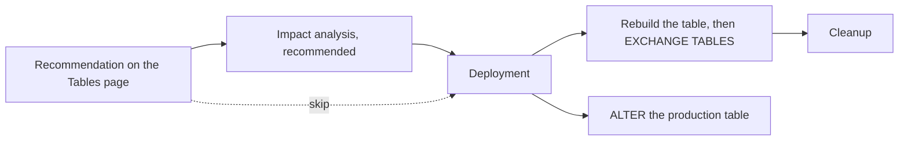

import { PrivatePreviewBadge } from '/snippets/pt-BR/components/PrivatePreviewBadge/PrivatePreviewBadge.jsx';

<PrivatePreviewBadge />

O Schema Advisor ajuda você a migrar seu schema no ClickHouse Cloud, desde a recomendação, passando por uma análise de impacto em uma amostra dos seus dados, até uma implantação aprovada por você.

No ClickHouse, o schema determina como uma tabela é armazenada: a chave primária, a chave `ORDER BY`, a compressão, os índices e as projeções. Um `ORDER BY` melhor pode transformar uma varredura completa da tabela na leitura de poucos grânulos,
e um codec de compressão melhor pode reduzir o armazenamento ocupado por uma tabela.
Fazer essa alteração em uma tabela de produção exige um plano, a validação desse plano e uma implantação gradual com o mínimo possível de indisponibilidade.

O Schema Advisor ajuda você nesse trabalho. As recomendações vêm dos seus logs de consultas em [Monitoramento](/pt-BR/products/cloud/features/monitoring/recommendations#schema-recommendations) e se baseiam em testes determinísticos, sem serem geradas por IA.
Se você quiser colocar essas recomendações em prática, o Schema Advisor propõe um plano para ajudar você a chegar lá.
Um fluxo de trabalho durável executa o SQL, e você aprova cada passo antes que o fluxo de trabalho prossiga.

<Warning>
  O Schema Advisor é uma funcionalidade em prévia. Ela pode sofrer alterações e não está coberta pelo SLA padrão do ClickHouse Cloud.
</Warning>

## Solicitar acesso {#request-access}

O Schema Advisor está disponível no ClickHouse Cloud. Esta prévia não inclui [Bring Your Own Cloud (BYOC)](/pt-BR/cloud/reference/byoc/overview) nem [ClickHouse Private](/pt-BR/cloud/infrastructure/clickhouse-private).

<Steps>
  <Step title="Abra os recursos em versão prévia">
    Faça login no Console do Cloud, selecione sua organização e abra **recursos em versão prévia** no menu da organização. Consulte [Prévias de autosserviço](/pt-BR/products/cloud/features/self-service-previews).
  </Step>

  <Step title="Solicite acesso ao Schema Advisor">
    Localize **Schema Advisor**, selecione **Learn more** e, em seguida, **Request access**. Avisaremos você por e-mail quando o acesso for liberado.
    Algumas prévias ficam ocultas para determinadas organizações. Caso o Schema Advisor não apareça na lista, entre em contato com o [Suporte do Cloud](https://clickhouse.com/support/program).
  </Step>
</Steps>

## Como uma alteração se propaga {#how-a-change-moves}

A análise de impacto é opcional, mas altamente recomendada. Se você confia na recomendação, pode passar direto para a implantação da alteração de esquema.
Caso contrário, execute primeiro a análise de impacto para ver como a alteração afeta suas consultas antes que qualquer mudança chegue à tabela de produção.

## Comece a partir de uma recomendação {#start-from-a-recommendation}

Depois que sua organização tiver acesso, abra um serviço e acesse [**Monitoramento**](/pt-BR/products/cloud/features/monitoring/cloud-console) e, em seguida, **Tables**.
O Schema Advisor mostra a recomendação para uma tabela e as consultas que a originaram. Consulte [Query insights](/pt-BR/products/cloud/features/sql-console-features/query-insights) para ver o log de consultas em que essas recomendações se baseiam.
Quando estiver pronto para aplicar a recomendação, clique em **Generate Implementation Plan** na parte inferior da página da recomendação.
É na página Tables que ficam a recomendação e os planos de implementação. Você pode voltar a essa página a qualquer momento para dar continuidade à implementação ou retomar a conversa no ClickHouse Assistente.

Se você já sabe qual alteração de esquema deseja e ela não aparece para essa tabela, pode começar pelo ClickHouse Assistente.
Descreva a alteração e peça ao Schema Advisor que oriente você durante o processo.
Por exemplo: &quot;Gostaria de alterar a chave primária da minha tabela default.sales&#95;analysis. Use o Schema Advisor para me ajudar com isso.&quot;

Você também pode pedir recomendações ao ClickHouse Assistente. Primeiro, ele verificará se já existem recomendações determinísticas
e também fará algumas análises ad hoc para oferecer recomendações adicionais.
Recomendamos fortemente executar uma análise de impacto antes de implantar as recomendações geradas pelo LLM.

## Análise de impacto {#impact-analysis}

O Schema Advisor elabora um plano e exibe o SQL de cada passo. Depois que você aprovar, o fluxo de trabalho será executado.

1. Coletamos uma amostra da tabela de produção para usar como tabela de referência. Atualmente, essa amostra tem 10,000,000 linhas.
2. Com base na leitura da tabela de referência, criamos uma tabela candidata com o schema proposto.
3. Reaplicamos 3 vezes as consultas executadas com mais frequência nessa tabela de produção, tanto na tabela de referência quanto na tabela candidata.
4. Os resultados exibem essas execuções lado a lado, com a média calculada entre as consultas. As métricas comparadas são: tempo de execução da consulta, linhas varridas e dados lidos.

Você pode escolher onde a análise será executada:

* **No serviço atual.** A análise usa o serviço em que você já está.
* **Em um serviço isolado.** O Schema Advisor cria um serviço efêmero separado, restaurado a partir do seu backup mais recente. Para usar essa opção, é necessário ter backups configurados.
  As consultas de benchmarking são executadas nessa cópia dos dados. Isso é diferente de um [warehouse](/pt-BR/products/cloud/features/infrastructure/warehouses), no qual os serviços compartilham o mesmo armazenamento.

## Implantar uma alteração {#deploy-a-change}

Se os resultados da análise de impacto forem satisfatórios, você poderá implantar a alteração em seguida. Caso contrário, poderá descartar a recomendação. A execução varia conforme o tipo de alteração.

* **Reconstrução completa da tabela.** Estas alterações de esquema exigem uma reconstrução completa: alterar a ordenação ou alterar a chave primária.
  O Schema Advisor cria a nova tabela, copia os dados, verifica a cópia e, em seguida, a coloca no lugar da original com [`EXCHANGE TABLES`](/pt-BR/sql-reference/statements/exchange).
  A troca é atômica, portanto o nome de produção passa a apontar para a nova tabela sem indisponibilidade.
  O Schema Advisor mostra a instrução exata, e o fluxo de trabalho a executa depois que você a aprova.
  Após a troca, a tabela antiga não é removida automaticamente. A [limpeza](#cleanup) só é executada depois que você clica no botão.
* **`ALTER TABLE`.** Estas alterações são aplicadas diretamente, sem reconstrução e sem `EXCHANGE TABLES`. Entre elas estão a adição de um índice ou de uma projeção.
  O Schema Advisor mostra a instrução `ALTER` exata. Depois que você a aprova, o fluxo de trabalho executa essa instrução na tabela de produção.

## Limpeza {#cleanup}

Após uma reconstrução completa da tabela, a tabela antiga é mantida como backup. A limpeza só é executada quando você clica no botão **Clean up**.
Ao clicar nele, o Schema Advisor remove todas as tabelas de backup existentes e todos os serviços efêmeros.

## Modelos e tratamento de dados {#models-and-data-handling}

Por padrão, as chamadas ao modelo feitas pelo Schema Advisor passam pelo ClickHouse Inference Gateway no Amazon Bedrock.

Não treinamos modelos com os seus dados. As únicas informações enviadas ao modelo são os metadados do esquema da sua tabela e a recomendação.

## Limitações {#limitations}

Nesta prévia privada, não é possível implantar uma alteração que exija a reconstrução completa da tabela nos seguintes casos:

* A tabela recebe ingestão contínua de dados.
* A tabela tem mais de 100 milhões de linhas ou mais de 100 GB, o que for atingido primeiro. Mesmo assim, você ainda pode gerar um plano e executar a análise de impacto.
* A tabela tem dependências downstream, incluindo [visões materializadas](/pt-BR/materialized-views).

## Páginas relacionadas {#related-pages}

* [Monitoramento no Console do Cloud](/pt-BR/products/cloud/features/monitoring/cloud-console)
* [Query insights](/pt-BR/products/cloud/features/sql-console-features/query-insights)
* [Warehouses](/pt-BR/products/cloud/features/infrastructure/warehouses)
* [Design de schema](/pt-BR/data-modeling/schema-design)
* [Prévias de autosserviço](/pt-BR/products/cloud/features/self-service-previews)
* [`EXCHANGE`](/pt-BR/sql-reference/statements/exchange)