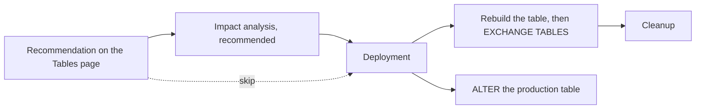

import { PrivatePreviewBadge } from '/snippets/ru/components/PrivatePreviewBadge/PrivatePreviewBadge.jsx';

<PrivatePreviewBadge />

Schema Advisor помогает выполнить миграцию схемы в ClickHouse Cloud: от рекомендации через анализ влияния на выборке ваших данных до одобренного вами развертывания.

В ClickHouse схема определяет, как хранится таблица: первичный ключ, ключ `ORDER BY`, сжатие, индексы и проекции. Более удачный `ORDER BY` может превратить полное сканирование таблицы в чтение нескольких гранул,
а более подходящий кодек сжатия — сократить объём хранилища, занимаемого таблицей.
Чтобы внести такое изменение в продукционную таблицу, нужны план, проверка этого плана и поэтапное развёртывание с минимальным временем простоя.

Schema Advisor помогает в этой работе. Рекомендации формируются на основе ваших журналов запросов в разделе [Мониторинг](/ru/products/cloud/features/monitoring/recommendations#schema-recommendations) с помощью детерминированных тестов, а не генерируются ИИ.
Если вы хотите применить эти рекомендации, Schema Advisor предложит план их реализации.
SQL выполняется надёжным рабочим процессом, и перед каждым следующим шагом рабочий процесс ожидает вашего одобрения.

<Warning>
  Schema Advisor находится в статусе предварительной версии. Эта возможность может изменяться и не покрывается стандартным SLA ClickHouse Cloud.
</Warning>

## Запрос доступа {#request-access}

Schema Advisor доступен в ClickHouse Cloud. Эта предварительная версия не распространяется на [Собственное облако (BYOC)](/ru/cloud/reference/byoc/overview) и [ClickHouse Private](/ru/cloud/infrastructure/clickhouse-private).

<Steps>
  <Step title="Откройте раздел предварительных версий функций">
    Войдите в консоль Cloud, выберите свою организацию и откройте раздел **предварительные версии функций** в меню организации. Подробнее см. в разделе [Предварительные версии с самообслуживанием](/ru/products/cloud/features/self-service-previews).
  </Step>

  <Step title="Запросите доступ к Schema Advisor">
    Найдите **Schema Advisor**, нажмите **Learn more**, а затем — **Request access**. Когда доступ будет открыт, мы уведомим вас по электронной почте.
    Некоторые предварительные версии недоступны отдельным организациям. Если Schema Advisor отсутствует в списке, обратитесь в [службу поддержки Cloud](https://clickhouse.com/support/program).
  </Step>
</Steps>

## Как распространяется изменение {#how-a-change-moves}

Анализ влияния необязателен, но настоятельно рекомендуется. Если вы доверяете рекомендации, можно сразу перейти к развертыванию изменения схемы.
В противном случае сначала выполните анализ влияния: так вы увидите, как изменение скажется на ваших запросах, ещё до того, как будет затронута продукционная таблица.

## Начните с рекомендации {#start-from-a-recommendation}

После того как ваша организация получит доступ, откройте сервис и перейдите в раздел [**Мониторинг**](/ru/products/cloud/features/monitoring/cloud-console), затем **Tables**.
Schema Advisor показывает рекомендацию для таблицы и запросы, на основе которых она сформирована. Журнал запросов, на котором основаны эти рекомендации, описан в разделе [Аналитика запросов](/ru/products/cloud/features/sql-console-features/query-insights).
Когда будете готовы применить рекомендацию, нажмите **Generate Implementation Plan** внизу страницы рекомендации.
Рекомендация и планы реализации хранятся на странице Tables. Вы всегда можете вернуться на эту страницу, чтобы продолжить реализацию, или продолжить диалог в ClickHouse Assistant.

Если вы знаете, какое изменение схемы вам нужно, но для этой таблицы оно не предлагается, можно начать с ClickHouse Assistant.
Опишите изменение и попросите Schema Advisor пошагово провести вас через него.
Например: «I would like to change the primary key of my table default.sales&#95;analysis. Use Schema Advisor to help me do this.»

Вы также можете запросить рекомендации у ClickHouse Assistant. Сначала он проверит, есть ли уже сформированные детерминированные рекомендации,
а затем проведёт разовый анализ, чтобы предложить дополнительные.
Настоятельно рекомендуем выполнить анализ влияния, прежде чем развёртывать рекомендации, сгенерированные LLM.

## Анализ влияния {#impact-analysis}

Schema Advisor формирует план и показывает SQL для каждого шага. После того как вы его одобрите, запускается рабочий процесс.

1. В качестве базовой таблицы мы берём выборку из продукционной таблицы. Сейчас размер выборки составляет 10,000,000 строк.
2. На основе данных базовой таблицы мы создаём таблицу-кандидат с предлагаемой схемой.
3. Мы по 3 раза повторно выполняем на базовой таблице и таблице-кандидате запросы, которые чаще всего выполняются на этой продукционной таблице.
4. Результаты этих запусков выводятся рядом и усредняются по всем запросам. Сравниваются следующие метрики: время выполнения запроса, количество просканированных строк и объём прочитанных данных.

Вы можете выбрать, где будет выполняться анализ:

* **В текущем сервисе.** Анализ выполняется в сервисе, в котором вы сейчас работаете.
* **В изолированном сервисе.** Schema Advisor создаёт отдельный эфемерный сервис, восстановленный из вашей последней резервной копии. Для этого у вас должно быть настроено резервное копирование.
  Запросы бенчмаркинга выполняются на этой копии данных. Это не то же самое, что [хранилище](/ru/products/cloud/features/infrastructure/warehouses), в котором сервисы используют общее хранилище данных.

## Развертывание изменения {#deploy-a-change}

Если результаты анализа влияния вас устраивают, изменение можно развернуть. В противном случае рекомендацию можно отклонить. Порядок выполнения зависит от типа изменения.

* **Полное перестроение таблицы.** Полного перестроения требуют следующие изменения схемы: изменение порядка сортировки или первичного ключа.
  Schema Advisor создаёт новую таблицу, копирует данные, проверяет копию, а затем подставляет её на место исходной с помощью [`EXCHANGE TABLES`](/ru/sql-reference/statements/exchange).
  Обмен выполняется атомарно, поэтому имя в продакшне начинает указывать на новую таблицу без простоя.
  Schema Advisor показывает точный оператор, а рабочий процесс выполняет его после вашего одобрения.
  После обмена старая таблица автоматически не удаляется. [Очистка](#cleanup) выполняется только после нажатия соответствующей кнопки.
* **`ALTER TABLE`.** Эти изменения применяются на месте, без перестроения и без `EXCHANGE TABLES`. К ним относится, например, добавление индекса или проекции.
  Schema Advisor показывает точный оператор `ALTER`. После вашего одобрения рабочий процесс выполняет этот оператор на продукционной таблице.

## Очистка {#cleanup}

После полного перестроения таблицы старая таблица остаётся в качестве резервной копии. Очистка запускается только после нажатия кнопки **Clean up**.
После этого Schema Advisor удаляет все существующие резервные таблицы и все эфемерные сервисы.

## Модели и обработка данных {#models-and-data-handling}

По умолчанию обращения Schema Advisor к моделям проходят через ClickHouse Inference Gateway на Amazon Bedrock.

Мы не обучаем модели на ваших данных. Модели передаются только метаданные о схеме вашей таблицы и сама рекомендация.

## Ограничения {#limitations}

В этой закрытой предварительной версии развертывание изменения, требующего полного перестроения таблицы, недоступно в следующих случаях:

* В таблицу непрерывно поступают данные.
* Таблица содержит более 100 миллионов строк или её размер превышает 100 ГБ — в зависимости от того, какой из лимитов будет достигнут первым. При этом вы по-прежнему можете составить план и выполнить анализ влияния.
* У таблицы есть нижестоящие зависимости, в том числе [materialized view](/ru/materialized-views).

## Связанные страницы {#related-pages}

* [Мониторинг в консоли Cloud](/ru/products/cloud/features/monitoring/cloud-console)
* [Аналитика запросов](/ru/products/cloud/features/sql-console-features/query-insights)
* [Хранилища](/ru/products/cloud/features/infrastructure/warehouses)
* [Проектирование схемы](/ru/data-modeling/schema-design)
* [Предварительные версии в режиме самообслуживания](/ru/products/cloud/features/self-service-previews)
* [`EXCHANGE`](/ru/sql-reference/statements/exchange)