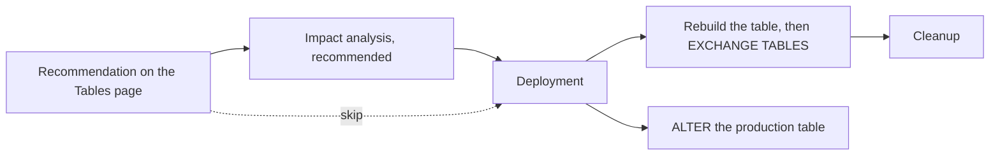

import { PrivatePreviewBadge } from '/snippets/zh/components/PrivatePreviewBadge/PrivatePreviewBadge.jsx';

<PrivatePreviewBadge />

Schema Advisor 可帮助您在 ClickHouse Cloud 中完成 schema 迁移：从一条建议出发，经过基于数据样本的影响分析，直至由您批准的部署。

在 ClickHouse 中，schema 决定了表的存储方式：主键、`ORDER BY` 键、压缩、索引以及投影。更合适的 `ORDER BY` 可以将全表扫描变为仅读取少量粒度，
而更合适的压缩编解码器则可以减少表占用的存储。
要在生产表上进行此类变更，您需要制定执行计划、对该计划进行校验，并在尽可能缩短停机时间的前提下完成滚动发布。

Schema Advisor 可协助您完成这些工作。建议来源于[监控](/zh/products/cloud/features/monitoring/recommendations#schema-recommendations)中的查询日志，基于确定性的测试得出，而非由 AI 生成。
如果您希望采纳这些建议，Schema Advisor 会提出相应的执行计划，帮助您落实变更。
SQL 由持久化工作流执行，每个步骤都需经您批准后，工作流才会继续。

<Warning>
  Schema Advisor 是一项预览功能，后续可能会有变化，且不在标准 ClickHouse Cloud SLA 的保障范围内。
</Warning>

## 申请访问权限 {#request-access}

Schema Advisor 现已在 ClickHouse Cloud 中提供。本次预览不包括[自备 Cloud (BYOC) ](/zh/cloud/reference/byoc/overview)或 [ClickHouse Private](/zh/cloud/infrastructure/clickhouse-private)。

<Steps>
  <Step title="打开预览功能">
    登录 Cloud 控制台，选择您的组织，然后从组织菜单中打开 **预览功能**。详见[自助服务预览](/zh/products/cloud/features/self-service-previews)。
  </Step>

  <Step title="申请访问 Schema Advisor">
    找到 **Schema Advisor**，选择 **Learn more**，然后选择 **Request access**。访问权限开通后，我们会通过电子邮件通知您。
    部分预览功能对某些组织不可见。如果列表中没有 Schema Advisor，请联系 [Cloud 技术支持](https://clickhouse.com/support/program)。
  </Step>
</Steps>

## 变更如何流转 {#how-a-change-moves}

影响分析并非必需，但强烈建议执行。如果您信任该建议，可以直接跳到部署 schema 变更的步骤。
否则，请先运行影响分析，以便在生产表发生任何改动之前，了解该变更会对您的查询产生哪些影响。

## 从推荐开始 {#start-from-a-recommendation}

组织获得访问权限后，打开一个服务，进入 [**监控**](/zh/products/cloud/features/monitoring/cloud-console)，然后选择 **Tables**。
Schema Advisor 会显示针对某个表的推荐，以及生成该推荐所依据的查询。如需了解这些推荐所基于的查询日志，请参阅[查询洞察](/zh/products/cloud/features/sql-console-features/query-insights)。
准备好应用推荐后，点击推荐页面底部的 **Generate Implementation Plan**。
推荐和实施计划都位于 Tables 页面。您可以随时返回该页面继续实施，也可以在 ClickHouse Assistant 中继续对话。

如果您已经明确想要进行的 schema 变更，但该表并未显示相应推荐，可以从 ClickHouse Assistant 入手。
描述所需的变更，并让 Schema Advisor 引导您逐步完成。
例如：“I would like to change the primary key of my table default.sales&#95;analysis. Use Schema Advisor to help me do this.”

您也可以向 ClickHouse Assistant 寻求推荐。它会先检查是否已有确定性的推荐，
同时进行一些临时分析，以提供更多推荐。
我们强烈建议在部署 LLM 生成的推荐之前，先运行影响分析。

## 影响分析 {#impact-analysis}

Schema Advisor 会构建一个执行计划，并展示每个步骤的 SQL。您批准后，工作流即开始执行。

1. 我们从生产表中抽取一个样本作为基线表。目前样本大小为 10,000,000 行。
2. 基于基线表中读取的数据，使用建议的 schema 构建候选表。
3. 我们选取该生产表上执行最频繁的查询，在基线表和候选表上分别重放 3 次。
4. 结果会将这些运行并排展示，并按查询取平均值。比较的指标包括：查询时间、扫描行数和读取的数据量。

您可以选择在何处运行分析：

* **在当前服务中。** 分析将直接使用您当前所在的服务。
* **在隔离服务中。** Schema Advisor 会基于您最新的备份恢复出一个独立的临时服务。使用此选项前，您必须已配置备份。
  基准测试查询将在该数据副本上运行。这与[仓库](/zh/products/cloud/features/infrastructure/warehouses)不同，仓库中的各个服务共享同一存储。

## 部署变更 {#deploy-a-change}

如果您认可影响分析的结果，即可进行部署；否则，可以忽略该建议。具体执行方式因变更类型而异。

* **全表重建。** 以下 schema 变更需要全表重建：更改排序顺序或更改主键。
  Schema Advisor 会创建新表、复制数据、校验副本，然后通过 [`EXCHANGE TABLES`](/zh/sql-reference/statements/exchange) 将新表交换到位。
  该交换操作是原子性的，因此生产表名会直接指向新表，不会产生停机时间。
  Schema Advisor 会显示具体的语句，并在您批准后由工作流执行该语句。
  交换完成后，旧表不会被自动删除。只有在您点击相应按钮后，才会执行[清理](#cleanup)。
* **`ALTER TABLE`。** 此类变更会原地生效，无需重建，也不涉及 `EXCHANGE TABLES`，例如添加索引或投影。
  Schema Advisor 会显示具体的 `ALTER` 语句。在您批准后，工作流会在生产表上执行该语句。

## 清理 {#cleanup}

全表重建后，旧表将作为备份保留。只有在您点击 **Clean up** 按钮后，才会执行清理。
点击该按钮后，Schema Advisor 会删除所有现有的备份表以及所有临时服务。

## 模型与数据处理 {#models-and-data-handling}

默认情况下，Schema Advisor 的模型调用会经由 Amazon Bedrock 上的 ClickHouse Inference Gateway 进行。

我们不会使用您的数据训练模型。发送给模型的信息仅限于您的表结构元数据以及推荐内容。

## 限制 {#limitations}

在此私有预览阶段，以下情况无法部署全表重建变更：

* 该表持续摄取数据。
* 该表行数超过 1 亿或大小超过 100 GB (以先达到的限制为准) 。在这种情况下，您仍可构建执行计划并运行影响分析。
* 该表存在下游依赖项，包括[物化视图](/zh/materialized-views)。

## 相关页面 {#related-pages}

* [Cloud 控制台中的监控](/zh/products/cloud/features/monitoring/cloud-console)
* [查询洞察](/zh/products/cloud/features/sql-console-features/query-insights)
* [仓库](/zh/products/cloud/features/infrastructure/warehouses)
* [Schema 设计](/zh/data-modeling/schema-design)
* [自助服务预览](/zh/products/cloud/features/self-service-previews)
* [`EXCHANGE`](/zh/sql-reference/statements/exchange)